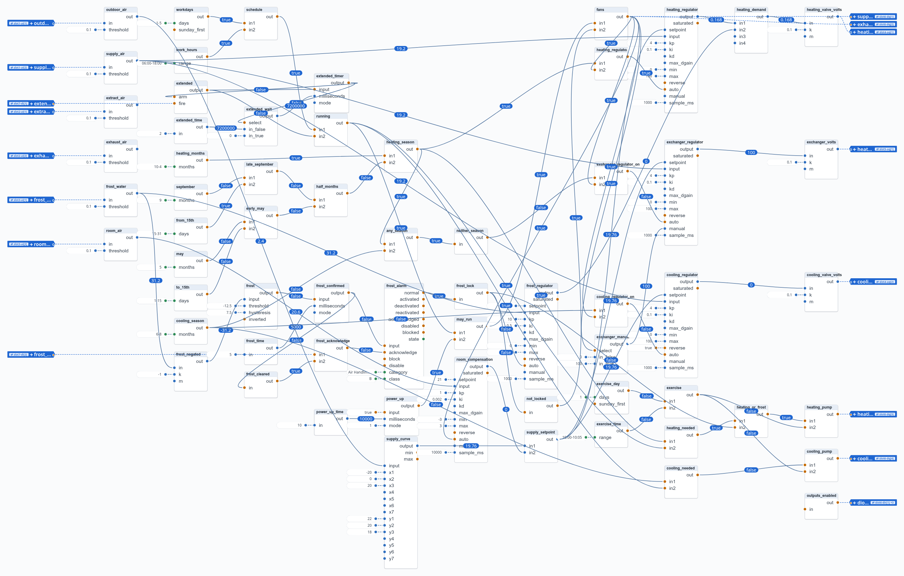
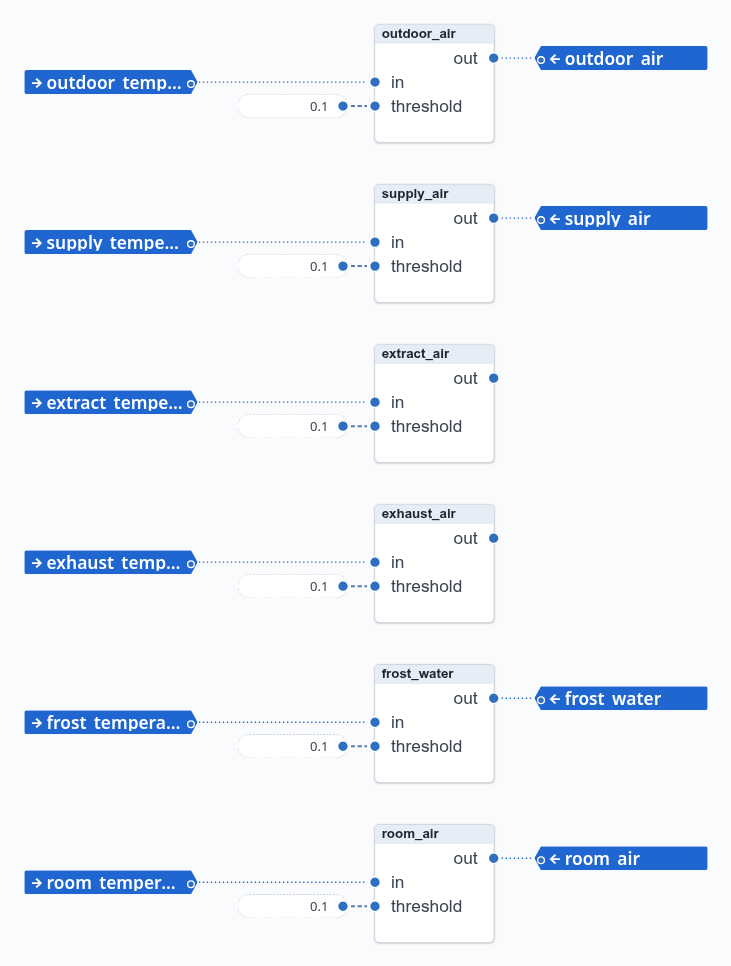
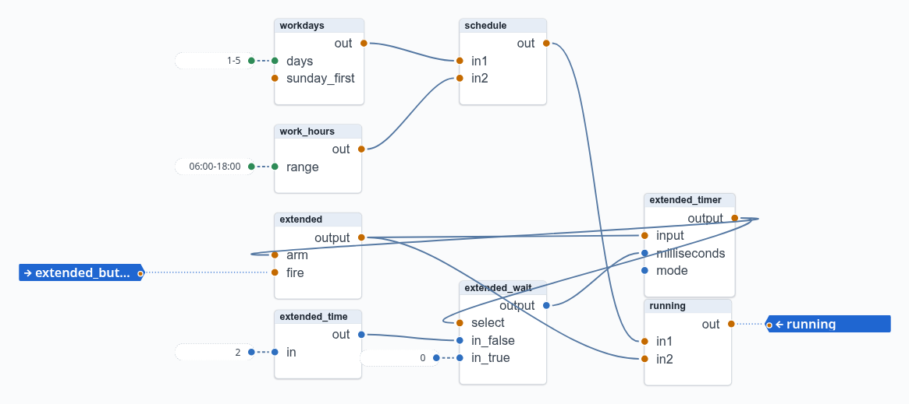
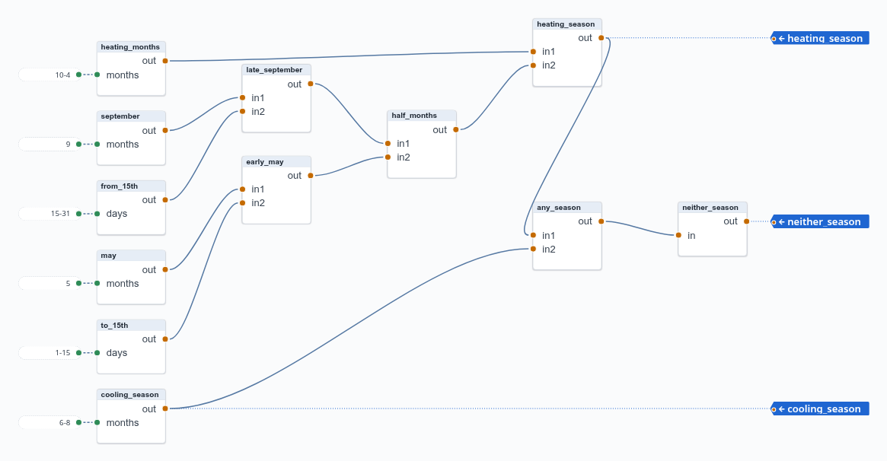
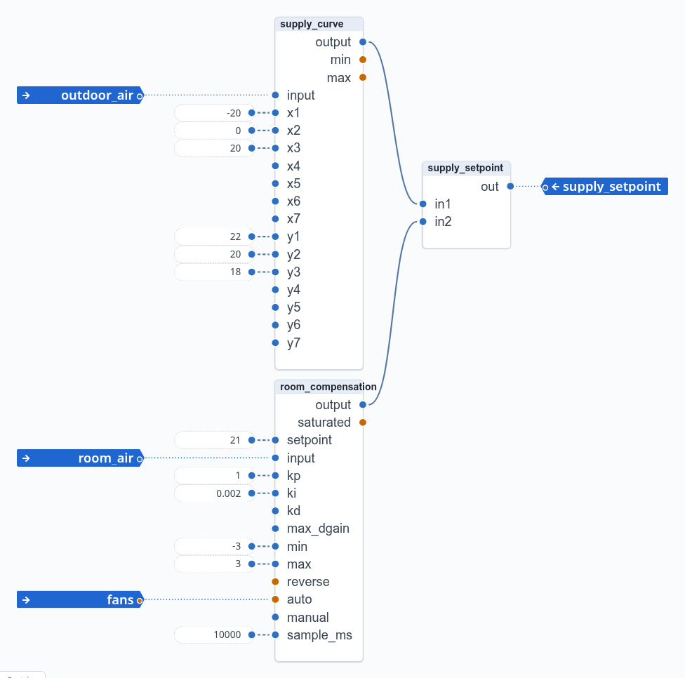
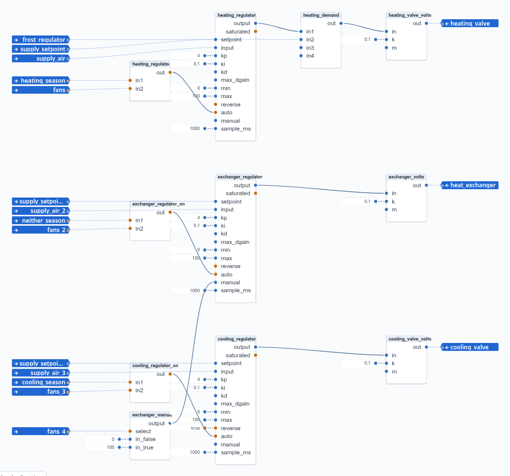
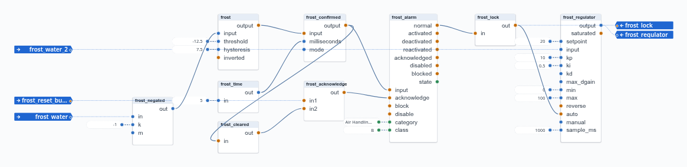
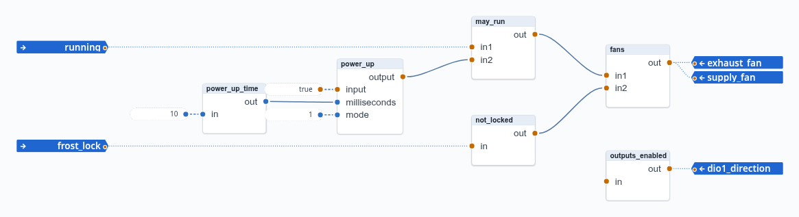
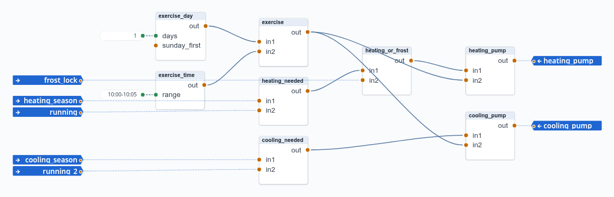

# 13. The air handling unit

The third example is a complete air handling unit (AHU). It has about sixty blocks in one process
and uses most block types. This chapter goes through it part by part: what each part does and
why it is built that way. It is the chapter to read when you design a unit of your own.

The example is in `examples/ahu/`. Upload `Air Handling Unit.process.json` to look at it while
you read, and run it against the emulator with `examples/ahu/ahu.json` (Appendix D).

## 13.1 The unit and its I/O list

**The equipment:**
- a supply fan and an exhaust fan, on/off; the dampers follow the fans;
- a rotary heat exchanger, an analog signal (the rotor's speed, or a run-around coil's shunt);
- a heating coil with its valve, a pump, and a water temperature sensor for frost protection;
- a cooling coil with its valve and pump;
- temperature sensors in the four air streams and in the room;
- an *Extended operation* push button, and a frost reset button.

**The I/O**, on one Colibri 8 with all seven slots in use:

| Slot | Module | Channel 1 | Channel 2 | Channels 3–4 |
|---|---|---|---|---|
| 1 | Pt1000 | outdoor air | supply air | |
| 2 | Pt1000 | extract air (from the room) | exhaust air (out of the building) | |
| 3 | Pt1000 | heating coil water (frost) | room | |
| 4 | AQV, 0–10 V | heating valve | cooling valve | |
| 5 | AQV, 0–10 V | heat exchanger | *spare* | |
| 6 | DIO1 | supply fan | exhaust fan | heating pump, cooling pump |
| 7 | DIU | Extended operation | frost reset | *spare* |

**Left out on purpose**, as on many real units:
- **Fire and smoke.** By regulation these are often outside the AHU's controls.
- **Filter changes.** Service companies do them on a yearly schedule.
- **Run and fault indications.** They catch only some faults. Alarms go on what the unit is for
  instead: temperatures and efficiency (13.12).
- **A hard-wired frost thermostat.** If a project wants one, it is outside the automation.
- **Flow control.** The unit has no inverters and no flow sensors.

## 13.2 Structuring a larger process

Sixty blocks in one diagram are a lot to take in at once, and this is a modest unit. Three things
keep it workable:

- **It reads from left to right**: sensors on the left, then operation, seasons and setpoint,
  regulators, and outputs on the right. Each function sits in its own area.
- **Every block is named for what it does**: `frost_confirmed`, `heating_regulator_on`,
  `exchanger_manual`. A connection from `frost_lock` needs no explanation.
- **Each part has few connections to the others.** The operation part delivers one signal,
  `running`. The seasons part delivers three. Frost protection delivers `frost_lock` and its
  regulator's output.

The last point is what makes a part a candidate for a **composite block type** (13.11). In the
pictures below, each part is cut out on its own. The signals that come from other parts enter
as process inputs, named after their source, and those that leave are process outputs.

**Sensors.** Every temperature enters through a `process/Deadband` of 0.1 °C. It filters the
sensor's noise, and it gives the value one block to be connected from: a process input feeds
one input, and most temperatures are used more than once.

## 13.3 Operation: the schedule and Extended operation

**The schedule** is Monday–Friday (`workdays`, `1-5`) from 06:00 to 18:00 (`work_hours`), joined
in `schedule`.

**Extended operation**: a press of the button runs the unit for two hours, also outside the
schedule. It takes three blocks:

- `extended` (`process/Trigger`) turns on at the rising edge of `fire`, the button. It turns off
  at the rising edge of `arm`.
- `extended_timer` (`process/Delay`) passes `extended`'s output on after `milliseconds`. When it
  turns true, two hours after the press, it arms `extended`, which turns off.
- `extended_wait` (`process/SelectIn`) is the timer's duration: two hours (`2 → extended_time`,
  a `timing/Hours`) while the timer's output is false, and 0 once it is true. The timer then follows `extended` back to false
  **at once**, so `arm` falls, and the next press starts a fresh two hours.

Without `extended_wait`, the timer would hold its true for another two hours after `extended`
turned off, and a press in that time would be cut short. This is an example of a pattern: a
block's own output, fed back, changes how it behaves (Section 14.8).

`running` is the schedule **or** Extended operation.

## 13.4 Seasons

The unit works in three seasons, by date. In Scandinavia they do not overlap:

| Season | Dates | Supply air by |
|---|---|---|
| heating | 15 September – 15 May | the heating valve; heat exchanger at 100 % |
| cooling | 1 June – 31 August | the cooling valve; heat exchanger at 100 % |
| neither | in between | the heat exchanger alone, heating only |

Calendar blocks take whole months or days, so a date range is built from them:

- `heating_months`: October to April (`10-4`, a range that wraps over the new year);
- `late_september`: September **and** days 15–31;
- `early_may`: May **and** days 1–15.

`heating_season` is any of the three. `cooling_season` is June–August (`6-8`). `neither_season` is
**not** (`heating_season` **or** `cooling_season`).

Deriving *neither* from the other two means the three can never disagree. A configuration error
that made the heating and cooling seasons overlap is still possible; it is to raise an alarm
(13.12).

## 13.5 The supply air setpoint

The supply air setpoint has two parts, added in `supply_setpoint`:

- **A curve over the outdoor temperature** (`supply_curve`, `process/Curve`): −20 °C → 22 °C,
  0 °C → 20 °C, +20 °C → 18 °C. Colder outdoors means warmer supply air.
- **Room compensation** (`room_compensation`, a `process/PID`). It holds the room at 21 °C by
  shifting the setpoint, but by at most ±3 °C: its output limits, `min` −3 and `max` 3. It is
  slow, with a sample every 10 s and a small integral, because a room responds slowly. It runs
  while the fans do (`auto` from `fans`). When they stop it returns to its manual value, 0, so it
  starts the next morning from the plain curve.

This is a cascade in effect: the room regulator moves the supply air regulator's setpoint. The
output limits keep the room regulator from asking for supply air that is uncomfortable.

## 13.6 One regulator per season

Instead of one regulator that sequences heat exchanger, heating and cooling (a split-range
cascade), there is **one regulator per season**. Each is a `process/PID` on the supply air
temperature, with the same setpoint and its own actuator:

| Regulator | Actuator | Automatic when |
|---|---|---|
| `heating_regulator` | heating valve | heating season and fans on |
| `exchanger_regulator` | heat exchanger | neither season and fans on |
| `cooling_regulator` (`reverse`) | cooling valve | cooling season and fans on |

Outside its season, each regulator is in **manual** and holds its `manual` value:
- 0 % for the valves;
- for the heat exchanger, 100 % while the fans run and 0 % while they don't
  (`exchanger_manual`, a `process/SelectIn` on `fans`). That is the "heat exchanger at 100 %" of
  the heating and cooling seasons.

**Switching between manual and automatic is bumpless**: a regulator that goes to automatic
continues from its manual value. That is why the seasons' change in May and September, or the
fans' start in the morning, causes no jump.

**Percent, then volts.** The regulators work in 0–100 %. A `process/Linear` per output
(`heating_valve_volts`, …) turns that into 0–10 V for the AQV module. A valve with another signal
needs only another scaling.

**The heating valve** is driven by the larger of two regulators, `heating_regulator` and
`frost_regulator` (`heating_demand`, `math/Max`). So frost protection can always open the valve
further, whatever the supply air needs (13.7).

## 13.7 Frost protection and its alarm

A heating coil's water must not freeze. The rule:

1. When the water in the heating coil falls below 5 °C, **stop the fans**, raise an **alarm**, and
   **regulate the heating valve to hold the water at 20 °C**.
2. The unit **restarts only when the alarm is acknowledged, after the water has reached 20 °C**.
   An acknowledgement while it is still cold does not count.

The blocks:

- **Detecting frost.** `frost` is a `process/Hysteresis` on the negated temperature
  (`frost_negated`, −1 × T). It is on below 5 °C and off again only above 20 °C: threshold −12.5,
  hysteresis 7.5, on above −5 and off below −20. One block thus gives both limits of the rule.
- **Confirming it.** `frost_confirmed` (`process/Delay`, its time `5 → frost_time`, a
  `timing/Seconds`) passes frost on only when it lasts 5 seconds. A sensor reads 0 °C until its first value arrives, and that alone must not stop
  the unit.
- **The alarm.** `frost_alarm` (`process/Alarm`, class B: attend to during working hours) follows
  `frost_confirmed`. It goes *Activated*, then *Deactivated* when the frost is over, and *Normal*
  only when acknowledged.
- **Acknowledging.** `frost_acknowledge` is the frost reset button **and** `frost_cleared`
  (frost is no longer confirmed). A press while the water is still cold does not reach the
  alarm.
- **The lock.** `frost_lock` is **not** `normal`: the unit is locked from the alarm until it is
  acknowledged. The lock:
  - stops the fans (13.8);
  - runs the heating pump (13.9);
  - puts `frost_regulator` in automatic, holding the water at 20 °C. Its output goes through
    `heating_demand` to the valve.

The alarm block's states make the rule simple. *Deactivated* is exactly "the frost is over but no
one has acknowledged it". The lock is everything but *Normal*.

## 13.8 The fans, and what start-up teaches

`fans` drives both fan outputs. The fans run when the unit may run (`may_run`: `running` and the
start delay) **and** it is not locked by frost (`not_locked`).

**The start delay** is the lesson of this part. When the unit was first tested against the
emulator, its regulators started far off and took minutes to recover. The cause:

1. When the process starts, every block computes from its inputs as they are. The sensors' first
   values arrive a moment later, so at that moment every temperature reads 0 °C.
2. In the schedule, the fans start at once, and the season's regulator goes to automatic. It is
   bumpless, so it presets its integral from an error computed against 0 °C supply air.
3. When the real temperatures arrive, that integral is far off.

The cure is `power_up`, a `process/Delay` with a fixed `true` on its input, `mode` 1 (an
on-delay) and `10 → Seconds` (`power_up_time`) as its time. It turns true 10 seconds after the
start, by which time every sensor has delivered. Section 12.5 explains the mode, and Section
14.7 collects start-up patterns.

`outputs_enabled`, a `logic/Not` with nothing on its input and so always true, is the process
output `dio1_direction`. It is bound to the DIO1's four direction channels, which makes its
terminals outputs. A DIO1 terminal is an input until its
direction is set. Making that a part of the process means that the unit's outputs work wherever
the process runs.

**The frost test** found a second start-up effect: the frost sensor reads 0 °C before its first
value, which is "frost". That is why frost must last 5 seconds (13.7).

## 13.9 Pumps and their weekly exercise

- **The heating pump** runs in the heating season while the unit runs (`heating_needed`), and
  during a frost lock (`heating_or_frost`): frost protection needs the water moving.
- **The cooling pump** runs in the cooling season while the unit runs (`cooling_needed`).
- **Exercise.** Both pumps also run every Monday from 10:00 to 10:05, whatever the season
  (`exercise_day`, `exercise_time`, `exercise`), so that they do not seize.

## 13.10 Testing against the emulator

Every example is tested automatically: hakkas runs the example's process against the Colibri
emulator, with the example's environment, and the test sets temperatures and checks outputs.
For the AHU, `emulators/colibri/tests/ahu.test.ts` checks:

- that the process loads with all 19 bindings, and makes the DIO1's channels outputs;
- each season: the right regulator opens its valve when the supply air is too cold (or warm),
  and closes it when it is the other way; the heat exchanger at 100 % or regulating;
- outside the schedule: fans, pumps, valves and heat exchanger off;
- frost: the fans stop after 5 s, the heating valve opens, an early acknowledgement does not
  count, and an acknowledgement after the water is warm restarts the unit;
- Extended operation: a press runs the unit outside the schedule, it stops by itself, and a new
  press starts it again.

The test cannot set the clock, so it changes the example's calendar values to fit the moment
it runs. For example, it makes the schedule always on or never, and the season the current
month. It also shortens the waits. That is easy because settings are fixed values: the test
changes a number in the file, not the logic.

Tests like these are worth writing for any process before it goes to a plant: each is a
specification of the unit's behaviour that can be checked again after every change. See
`emulators/colibri/tests/` and `tests/example-rig.ts` for how they are built.

## 13.11 Exercise: composite types

The parts of this chapter are natural composite types: each has few inputs and outputs, and its
pictures above already show it as a block with ports. Some that would serve other units too:

| Type | Inputs | Outputs |
|---|---|---|
| `ahu/ExtendedOperation` | `button`, `minutes` | `on` |
| `ahu/Seasons` | (the dates as settings) | `heating`, `cooling`, `neither` |
| `ahu/FrostProtection` | `water_temperature`, `reset` | `lock`, `valve`, the alarm's state |
| `ahu/SeasonRegulator` | `setpoint`, `input`, `season`, `fans`, `manual` | `output` |
| `common/PumpExercise` | (day and time as settings) | `exercise` |

Make one of them (Chapter 7):
1. Select its blocks and choose *Create composite type…*.
2. Name its ports.
3. Replace the blocks with a block of the new type, and connect it.
4. Check with the emulator, or the test, that the unit behaves as before.

`ahu/SeasonRegulator` is used three times, which shows the point of a type. Note that its
settings (Kp, Ki, the limits) are then the same for all three unless you make them ports.

## 13.12 Alarms on the unit's goals

::: info To be designed
The alarms on the unit's goals are still to be designed with the user (plan X1). Frost
protection's alarm (13.7) is the only alarm so far.
:::

The idea is to raise alarms on what the unit is **for**, rather than on each component's status:

- **The supply air temperature** deviating from its setpoint for a while;
- **The room temperature** deviating from its setpoint;
- **The heat exchanger's efficiency**, from the four air temperatures:
  η = (extract − exhaust) / (extract − outdoor). A rotor that stopped shows here, whatever its own
  signals say;
- **Both seasons at once**, a configuration error (13.4).

Each is a `process/Alarm` on a condition, with a `process/Delay` so that a passing deviation does
not raise it.
