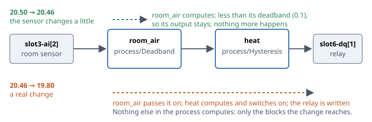
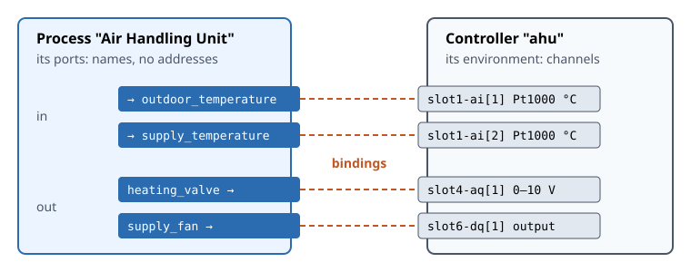

# 2. Concepts

This chapter introduces the handful of ideas everything else builds on. None of them is
complicated, but a few work differently from a PLC — especially 2.2, how values travel through a
process. Read it before you build anything.

## 2.1 Blocks, block types and instances

A **block** is one function in a process: a comparator, a PID regulator, a week schedule. Every
block is an instance of a **block type**, which defines its inputs, its outputs and what it
computes. Block types are named by family and name: `math/Add2`, `compare/Greater`,
`logic/And`, `process/PID`, `timing/DayOfWeek`. The families are listed in the editor's
*Block types* panel, and Chapter 15 describes every type.

A block has a **name** of its own, unique within its process — `heating_regulator`,
`frost_alarm`. Hakkas proposes one when you add a block (`PID_1`); give it a name that says what
it does, because names are what you read when the process grows.

Each input and output is a **port** with a name and a type. There are three types:

| Type | Holds | Shown as |
|---|---|---|
| number | a number (a 64-bit floating-point value) | a blue port |
| bool | true or false | an orange port |
| string | text | a green port |

## 2.2 Connections and dataflow

A **connection** carries the value of one block's output to another block's input. An output may
feed any number of inputs. An **input has at most one source**: one connection, or a fixed value
(2.3), or a binding to the I/O (2.5). Hakkas refuses a second one — there is no implicit "or" of
two wires into one input; you place a block that combines them.

**There is no scan cycle.** A block computes when one of its inputs changes. If an output then
has a new value, the value travels along the output's connections, and each block it reaches
computes in turn. A block that no change reaches does nothing at all.

**Only changes propagate.** A number output passes its value on only when it has moved by at
least the **change threshold** since it last did — 0.05 by default, set for the whole controller
in its configuration. Noise smaller than that stops at the first block. A bool or a string passes
on every change. Where one signal needs other filtering, put a `process/Deadband` block in its
line, so that the filtering is visible in the diagram.

**Order is the order of arrival.** All changes go through one queue, first in, first out: a
change and everything it causes are worked off in the order they arise. You rarely need to think
about it — but in a diagram where a block's output comes back to one of its own inputs, the order
can decide the result. Section 14.8 shows such a case and how to build it so that order does not
matter.

**Time.** Some blocks also compute on their own: a `process/PID` every `sample_ms`, a
`process/Delay` when its wait ends, a schedule block at the times its range starts and ends.
They do so on the controller's clock, and their results travel like any other change.

::: tip Coming from IEC 61131-3
A PLC runs every network of a task, top to bottom, in every cycle, whether its inputs changed or
not. Hakkas computes only what a change reaches, and only when it arrives. There is no
execution order to set: a block computes when its input has a new value. A regulator's sample
time is a setting of the regulator block, not of a task.
:::

## 2.3 Values

An input that is not connected can hold a **fixed value**: the setpoint 21, the selector
`"1-5"`, `true`. You set it in the editor, where it shows as a small box beside the input, and
you can change it at any time, also while the process runs.

An input fed by nothing holds its type's **resting value**: 0 for a number, false for a bool, an
empty text for a string — like an unconnected terminal at 0 V. (The inspector shows it as the
input's *Default*.) Every block type is designed so
that its inputs' resting values mean something sensible: a regulator rests in manual with its
output at 0, a schedule rests off, a limit block without limits passes its input through. When
you remove a connection, the input returns to its resting value at once, and that is a change
like any other.

Values convert where it makes sense: a bool output connected to a number input arrives as 0 or 1,
a number on a bool input is true when it is not 0.

## 2.4 Processes and their ports

A **process** is one diagram: a set of blocks and their connections that runs as a unit. A
controller runs several processes side by side, each started and stopped on its own — for
example one per air handling unit in a building. (*Process* and *graph* mean the same thing;
you will meet *graph* in file names.)

A process has **ports** of its own, its interface to the outside world: **inports**, through
which values come in, and **outports**, through which values go out. Each is a named block port
made visible — `outdoor_temperature` is the input of the block that takes the outdoor
temperature in, `heating_valve` the output that drives the valve. The editor shows them as markers
at the process's edges. Process ports are what you bind to the I/O (2.5).

A process is either **running** or **stopped**. Starting it starts every block: each computes once
and its outputs propagate, so the whole process takes its state from its inputs. Stopping it
stops the blocks; outputs keep their last values.

## 2.5 The environment and bindings

The controller's I/O is its **environment**: the channels of its modules, each with a name, a type
and a unit. A Pt1000 module in slot 1 offers `slot1-ai[1]` and `slot1-ai[2]` (°C); a DIO1 in slot
6 offers `slot6-dq[1]` to `slot6-dq[4]`. Channels that hakkas reads are **sensors**; channels it
writes are **actuators**.

A **binding** connects a process port to a channel: a sensor to an inport, an outport to an
actuator. A binding is a connection like the others: the inport's block takes the sensor's value
as its input's one source, and the actuator follows the outport. Each actuator channel has one
driver.

Because a process names its ports, not channels, the same process runs on another controller
with other modules in other slots: you bind its ports there. Bindings are kept with the process
and saved with it. Chapter 8 shows how to make them, and Chapter 9 how a process moves from the
emulator on your desktop to a device.

## 2.6 Composite block types

When a group of blocks does one recognizable job — "season", "frost protection", "pump with
exercise" — you can make it a **composite block type**: a block type of your own, built from other
blocks. You select the blocks and choose *Create composite type…*; their inputs and outputs that
connect to the rest of the process become the new type's ports. From then on it is in the
*Block types* panel like any other type, and each block of it runs the blocks inside.

Composite types are shared by every process on the controller, can contain other composite types,
and travel with a process when you download it. Chapter 7 describes them.

## 2.7 Live editing

The controller holds the processes; the browser shows them. Every edit you make is a request to
the controller, which applies it — or refuses it, with a message saying why — and then tells every
browser that has the process open what changed. The editor never shows a change the controller
has not made.

This has a few consequences worth knowing from the start:

- **Changes take effect at once**, in a running process too. A block you add to a running process
  starts immediately; a value you change is used by the next computation.
- **Changes are kept over a restart only once saved.** The process list marks a process with
  unsaved changes; *Save* writes it, with its bindings and whether it is running, to the
  controller's storage.
- **Several people can work at once.** Each sees the others' changes as they happen. Undo in your
  browser undoes your own changes, and skips one that someone else has changed since.
- **No state survives a stop.** A process that is started — by you, or by the controller after a
  power cut — starts its blocks afresh: a timer starts over, a regulator's integral starts from
  its manual value. Design for that: Section 14.7 shows how.

## 2.8 Coming from IEC 61131-3

If you know the IEC 61131-3 languages, this table maps their terms to hakkas'. Appendix A goes into
more detail.

| IEC 61131-3 | Hakkas |
|---|---|
| Program in Function Block Diagram (FBD) | Process |
| Function block instance | Block |
| Function block type (standard library) | Block type |
| User-defined function block | Composite block type |
| Connection (wire) in FBD | Connection |
| Constant on an input | Fixed value |
| Program's inputs and outputs, mapped to `%I`/`%Q` addresses | Process ports, bound to channels |
| Data types `BOOL`, `REAL`/`LREAL`, `STRING` | bool, number, string |
| Cyclic task and its interval | No counterpart: blocks compute on change; a regulator has its own sample time |
| Execution order of networks | The order in which changes arrive |
| Online change | Every edit: the editor is always online |
| Compile and download | No counterpart |
| `RETAIN` variables | No counterpart: blocks start afresh |
| Global variables between programs | Links between processes' ports (Chapter 11) |
| Structured Text, Ladder Diagram, Instruction List, SFC | Not available: hakkas programs are diagrams |
