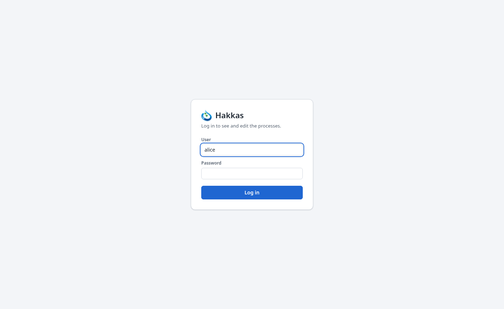

# 3. First contact

## 3.1 A device, or the emulator on your desktop

You work with hakkas in a web browser — a current Chrome, Chromium, Edge or Firefox. The controller
serves the editor itself, so all you need is its address.

- **On a device**, open the address the controller has on your network, for example
  `http://office-controller/`. Your administrator tells you which.
- **On your desktop**, you can run hakkas against the **Colibri emulator**, which behaves like a
  Colibri controller with the modules you choose: you set its inputs by hand and see its outputs.
  This is how to try the examples in this manual, and how to develop a process before it goes to
  a device. Appendix D shows how to start the two; the editor is then at
  `http://localhost:8080/`.

Everything in this manual works the same on both.

## 3.2 Logging in, and what your role allows

Log in with the user name and password your administrator gave you (Section 16.3 shows how users
are created). Your **role** decides what you may do:

| Role | May |
|---|---|
| viewer | see every process, its values and the I/O; change nothing |
| operator | also start and stop processes |
| editor | also change, create, delete, save and upload processes, make bindings and composite types |
| admin | the same as an editor, for now |

The editor only offers what your role allows: a viewer sees no *New…* and no block types to add.
The top bar shows your user name and role, and for a viewer or an operator a reminder of what that
means.

**Sessions.** You stay logged in while you work, also over a reload of the page. A session ends
after 30 minutes without activity or after 12 hours in all (an administrator can change both),
or when you choose *Logout*. If the connection to the controller is lost — a network glitch, a
controller restart — the editor says so and reconnects by itself; you do not lose your place.

## 3.3 A tour of the screen

The screenshot shows the thermostat of Chapter 4 running, with one block selected.

**① The top bar** shows who you are logged in as and your role. *Messages* opens a panel below
the editor with the controller's messages — for example why a change was refused; while it is
closed, the button counts new ones. *About* tells you which controller you are connected to and
its version. *Theme* switches between the light, dark and high-contrast looks; the choice is kept
in your browser.

**② The process list** shows the controller's processes. Each shows whether it runs (a green dot)
or is stopped, its name, how long it has been running, its description, and whether it has unsaved
changes. Click one to open it. Its actions — *Start* or *Stop*, *Save*, *Download*, *Rename*,
*Delete* — show on the open process and when you point at another. Above the list, *New…* creates
a process, *Upload…* and *Back up* move processes between controllers and files (Chapter 9), and
*Map* shows how the processes are linked (Chapter 11).

**③ The block types** are every type you can add, grouped in families: *Math*, *Compare*,
*Logic*, *Process*, *Timing*, and your own composite types. Type part of a name in the search field to find
one. Click a type to add a block of it, or drag it to where you want it.

**④ The environment** describes the controller's I/O: its name (here `thermostat`), the carrier board
and each slot with its module and channels. *Device* opens a picture of the controller with every
channel's live value (Section 8.2).

**⑤ The editor** shows the open process: its blocks, their connections, the fixed values beside
inputs, and the process ports at its edges. You pan it by dragging the background with the right
mouse button or by scrolling, zoom with Ctrl and the scroll wheel, and find your way in a large
process with the minimap in its corner. The legend at the bottom shows the port types' colors.
Right-click anything — the background, a block, a connection — for what you can do with it.

**⑥ The inspector** shows what is selected: a block's name (which you can change), its type and
description, and every input with its source — a connection, a fixed value or its default — and
its current value when you watch it. You set and change fixed values here too. With nothing
selected it says so; with several blocks selected, how many.

Chapter 5 describes the editor completely. The quickest way to learn it is to build something:
the next chapter builds a thermostat.
