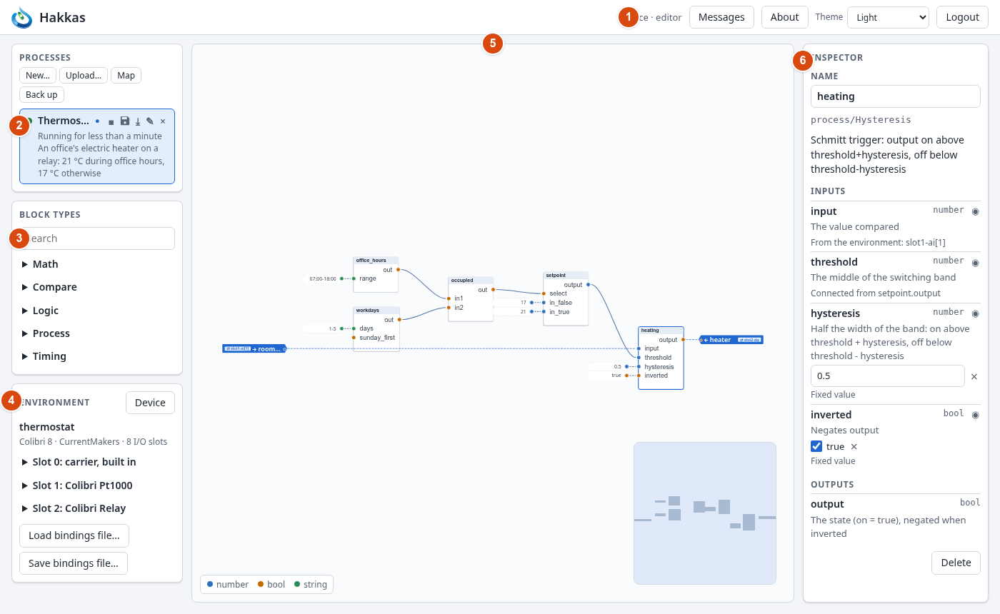

# 1. Introduction

## 1.1 What hakkas is

Hakkas is a runtime for control programs that are drawn rather than written. You place
**blocks** — an adder, a comparator, a PID regulator, a week schedule — on a canvas and connect
their outputs to other blocks' inputs. The resulting diagram is a **process**: a program that
runs on a controller and drives real outputs from real inputs.

Three parts work together:

- **The engine** runs on the controller: a Colibri device, a Raspberry Pi, or your own desktop
  for development. It holds every process, runs them, and keeps them on its storage so they
  start again after a power cut.
- **The environment** is the controller's I/O: the input and output channels of its modules —
  temperatures, voltages, relays. Processes reach it through **bindings**.
- **The browser** is where you work. The controller serves the editor as a web page; there is
  nothing to install. Several people can have it open at once, and all of them see the same
  processes, changing as they change.

## 1.2 How it differs from a PLC you know

If you have programmed PLCs, most of what you see will be familiar — function blocks, wires
between them, regulators, timers. A few things work differently, and they matter from the first
block on:

- **There is no compile and no download.** Every change you make — a block added, a wire moved,
  a value changed — is sent to the controller and applied at once, also to a process that is
  running. What the editor shows is always what runs.
- **There is no scan cycle.** A block computes when one of its inputs changes, and its outputs
  travel on only if they have changed. Values flow through the diagram as events, in the order
  they arrive. Chapter 2 explains what that means for your programs.
- **I/O is bound, not addressed.** A process does not name `%IW3` or a channel number. It has
  named ports — `outdoor_temperature`, `heating_valve` — and you bind each port to a channel of
  the controller. The same process runs on another controller after you bind its ports there.
- **The controller holds the truth.** The browser never has its own copy to "download". When
  two people edit the same process, each sees the other's changes as they happen.
- **Saving is a separate step.** A change takes effect at once, but it is kept over a restart
  only once you save the process.

## 1.3 How to read this manual

**The examples.** The manual is built around three examples that grow in size: a thermostat
with a schedule (Part II), a heating circuit (Part IV), and an air handling unit (Part V).
The thermostat is built step by step, and is the best way to learn the editor. The other two
show how larger control tasks are structured. All three run as they are against the Colibri
emulator on your desktop (Appendix D), so you can try everything without hardware.

**The parts.** Part I gives you the concepts and a first look at the screen. Part III describes
everything hakkas offers, chapter by chapter. Part VI collects design patterns, the reference of
every block type, and the administration of a controller.

**Coming from IEC 61131-3.** Notes like this one compare hakkas with the IEC 61131-3 languages
for readers who know them. You can skip them without missing anything.

::: tip Coming from IEC 61131-3
A hakkas process is closest to a program in the Function Block Diagram language (FBD), with
every block an instance of a function block. Appendix A has a complete comparison.
:::

**Typography.** Block names in a process are written as code: `heating_regulator`. Block types
carry their family: `process/PID`, `logic/And`. Things you click are in italics: *Upload…*,
*Start*. Channels are written as hakkas shows them: `slot1-ai[2]` is the second analog input of
the module in slot 1.
