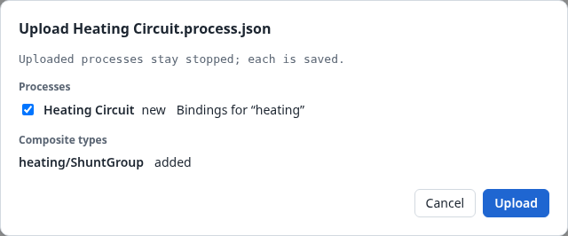
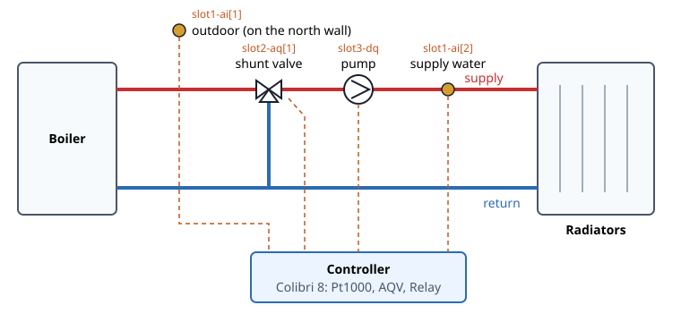
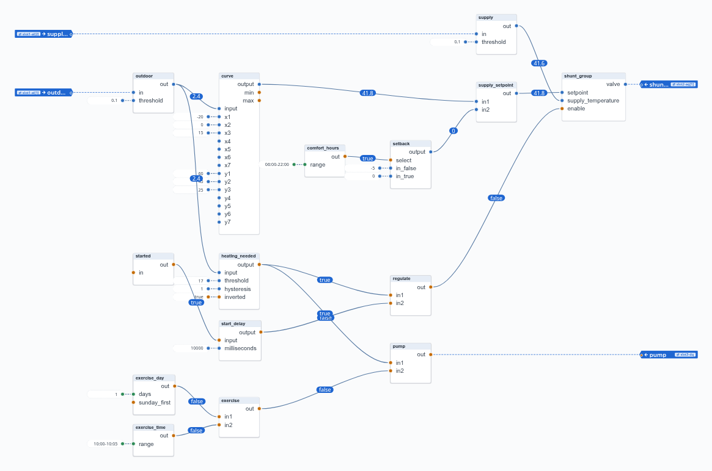
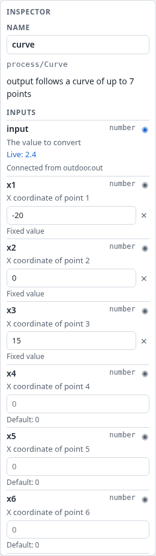
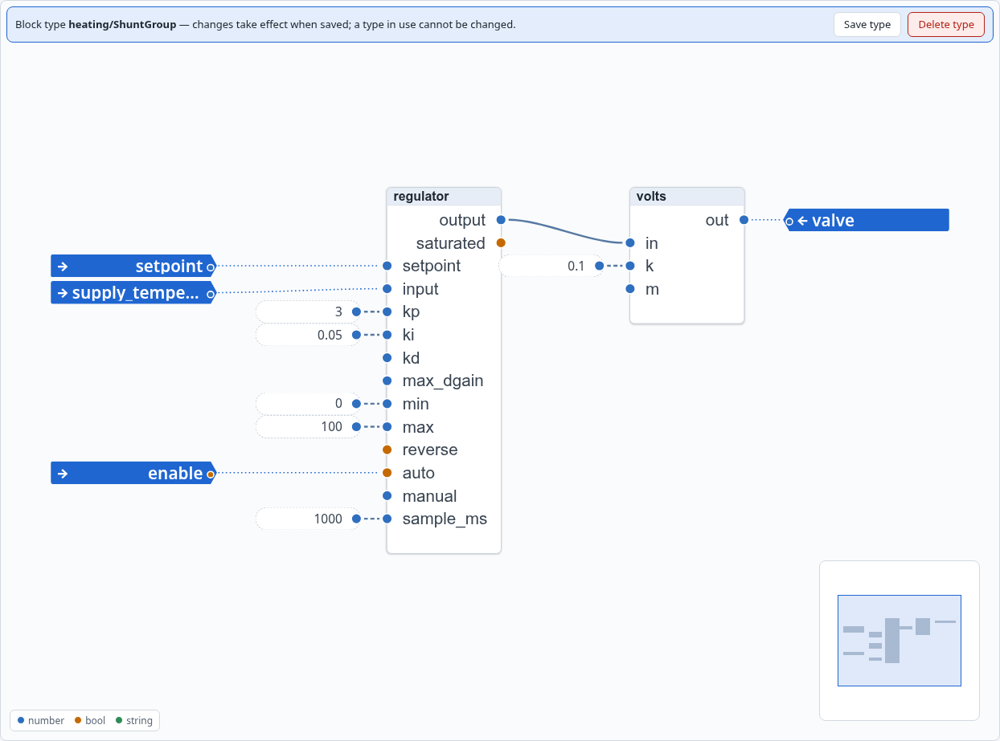

# 12. The heating circuit

The second example is a heating circuit: radiators fed through a shunt valve, with a circulation
pump. Every building with water-borne heat has one. It is larger than the thermostat, with about
fifteen blocks, and introduces three things that larger processes need:

- **a curve** that turns one value into another;
- **a composite block type** for a part that is complete in itself, the shunt group;
- **start-up behaviour**: what a regulator does in its first seconds.

The example is in `examples/heating-circuit/`. Upload `Heating Circuit.process.json` with
*Upload…* (Section 9.2) to follow along: it carries the process, its bindings and the composite
type it uses.

## 12.1 The circuit and its I/O

The boiler's water comes in at a temperature of its own. The **shunt valve** mixes it with the
radiators' return, so that the **supply water** to the radiators has the temperature they need.
The colder it is outdoors, the warmer the supply water must be. The **circulation pump** keeps the
water moving through the radiators.

The controller is a Colibri 8 with three modules:

| Channel | Module | Process port |
|---|---|---|
| `slot1-ai[1]` | Pt1000 | `outdoor_temperature` |
| `slot1-ai[2]` | Pt1000 | `supply_temperature` |
| `slot2-aq[1]` | AQV, 0–10 V | `shunt_valve` |
| `slot3-dq` | Relay | `pump` |

The whole process, running, with every connection watched:

It reads in two bands. At the top, from left to right, is **the supply water**: its setpoint and
its regulation. Below it is **when to heat**: the summer stop, the start delay, and the pump.

As in the air handling unit, each temperature enters through a `process/Deadband` of 0.1 °C
(`outdoor`, `supply`). It filters the sensor's noise. It also gives the value one block to be
connected from, since a process input feeds one input, and `outdoor` is used twice.

## 12.2 The supply water's setpoint: a curve

The relation between the outdoor temperature and the supply water's is the circuit's **heating
curve**. `process/Curve` draws it through up to seven points and interpolates in between:

| Outdoor (`x`) | Supply water (`y`) |
|---|---|
| −20 °C | 60 °C |
| 0 °C | 45 °C |
| +15 °C | 25 °C |

At 2.4 °C outdoors the curve gives 41.8 °C. Outside the points, the curve holds the nearest end:
below −20 °C it stays at 60 °C, and its output `min` is true. Above +15 °C it stays at 25 °C, and
`max` is true.

**Unused points drop out by themselves.** A point counts only if its `x` is greater than the
previous point's. Points 4 to 7 rest at `x = 0`, which is not greater than 15, so they are
ignored. You add a point by setting its `x` and `y`, and remove the last one by clearing its `x`.

**The night setback.** Between 22:00 and 06:00 the setpoint is 5 °C lower. `comfort_hours`
(`timing/MinuteRange`, `06:00-22:00`) chooses in `setback` (`process/SelectIn`) between 0 and −5
°C, and `supply_setpoint` (`math/Add2`) adds that to the curve. The same pattern, a selector
followed by an adder, makes any offset that depends on a condition (Section 14.1).

## 12.3 The shunt group: a composite block type

The shunt group is the regulator that holds the supply water at its setpoint by moving the
valve. Every heating circuit in a building has the same one, so it is made a **composite block
type**: `heating/ShuntGroup`. In the process it is one block, `shunt_group`, with three inputs
and one output:

| Port | | What |
|---|---|---|
| `setpoint` | number in | the supply water's setpoint, °C |
| `supply_temperature` | number in | the supply water's temperature, °C |
| `enable` | bool in | regulate while true, else the valve closed |
| `valve` | number out | the valve's signal, 0–10 V |

Open the type with ↗ in the palette to see inside:

- `regulator` is a `process/PID`:
  - Kp 3 %/K and Ki 0.05 %/(K·s), an integral time of 60 s, which suits a shunt;
  - output limits 0–100 %;
  - a sample every 1000 ms.

  Its `auto` input is the type's `enable`: in manual, the regulator holds its `manual` value,
  which rests at 0 %, so the valve is closed.
- `volts` is a `process/Linear` that turns percent into volts: `out = 0.1 × in`, so 0–100 % gives
  0–10 V.

The regulator works in percent and the scaling to volts is a block of its own, so the same
regulator suits a valve with another signal: change `volts`.

**What the composite type gives you:**
- **The process reads as what it does.** `shunt_group` says more than a PID and a Linear wired to
  each other.
- **One definition.** A second heating circuit on the same controller uses another block of the
  same type, with its own setpoint and sensor.
- **Settings in one place.** The PID's tuning is part of the type, the same for every block of it.
  To let each circuit have its own, make `kp` and `ki` ports of the type.

**Making it yourself.** Build the regulator and its scaling as blocks in the process, select
them, and choose *Create composite type…* (Chapter 7). Tick `regulator.setpoint`,
`regulator.input`, `regulator.auto` and `volts.out`, and name them as in the table above.

## 12.4 Summer stop

When it is warm outdoors there is nothing to heat. `heating_needed` (`process/Hysteresis`,
threshold 17 °C, hysteresis 1 °C, inverted) is:
- true below 16 °C;
- false above 18 °C;
- unchanged in between.

The band keeps a mild spring day from starting and stopping the pump all day long.

`heating_needed` decides both whether the shunt group regulates and whether the pump runs.

## 12.5 Start-up: the start delay

When the process starts, every block computes from its inputs **as they are at that moment**
(Section 6.3). The sensors' first values arrive a moment later, so for that moment
`supply_temperature` reads 0 °C, its resting value.

A PID regulator that goes to automatic in that moment sees an error of 40 °C or more. It switches
from manual without a bump: it presets its integral so that its output continues from its manual
value, 0 %. The preset is computed from that bogus error, and when the real temperature arrives
a moment later, the integral is far off. The valve then stays closed for minutes, until the
integral has worked its way back. The air handling unit (Section 13.9) met exactly this.

The cure is to let the regulator go to automatic only once the sensors have delivered:

- `started` is a `logic/Not` with nothing on its input, so its output is true. It sends that
  true when the process starts, like every block sends its outputs at the start.
- `start_delay` (`process/Delay`, 10 000 ms) passes that true on after 10 seconds.
- `regulate` (`logic/And`) enables the shunt group when heating is needed **and** the delay has
  passed.

**Why `started`, and not a fixed value `true` on the delay's input?** At the start, every block
first computes from its inputs as they are, and only then are the values that the blocks sent
delivered. A fixed value is on the delay's input before the start. A `process/Delay` takes its
input at once at the start, without delay, so it would pass `true` on immediately. The `Not`'s
true, in contrast, is delivered just after the start, as a **change**, and a change is what the
delay delays. This does not depend on the order in which the blocks were added. Section 14.7
describes the pattern.

## 12.6 The pump and its weekly exercise

The pump runs while heating is needed. A pump that stands still all summer can seize, so it
also runs every Monday from 10:00 to 10:05:

- `exercise_day` (`timing/DayOfWeek`, `1`) and `exercise_time` (`timing/MinuteRange`,
  `10:00-10:05`) are joined by `exercise` (`logic/And`);
- `pump` (`logic/Or`) is `heating_needed` or `exercise`.

During the exercise in summer the valve stays closed, since `regulate` is false.

Note that the pump has no start delay: it may run at once, and only the regulator must wait for
real values.

## 12.7 Running it against the emulator

Start the emulator with the example's environment `examples/heating-circuit/heating.json` and
hakkas against it (Appendix D). Upload the process, and start it:

1. **The start.** The pump runs at once (it is 2 °C outdoors in the emulator, so heating is
   needed). The valve stays at 0 V for 10 seconds, then begins to open.
2. **Regulation.** Set the supply water in the emulator's page below the setpoint: the valve
   opens, gradually, at the pace of the integral. Set it above: the valve closes.
3. **The curve.** Change the outdoor temperature and watch `supply_setpoint` follow the curve.
4. **Summer stop.** Set the outdoors to 20 °C: the pump stops and the valve closes. At 17 °C nothing
   changes, and at 15 °C both start again.

The same steps are an automatic test, `emulators/colibri/tests/heating-circuit.test.ts`. It runs
the example in hakkas against the emulator, with the calendar settings adapted to the moment it
runs (Section 13.10).

## 12.8 Exercises

1. **A second circuit.** Add a floor heating circuit to the same process: its own curve (−20 °C →
   35 °C, +15 °C → 22 °C), its own sensor, and a second block of `heating/ShuntGroup`.
2. **Tuning per circuit.** Make `kp` and `ki` ports of the shunt group type (open the type, expose
   them, save it), so that each circuit can have its own tuning. The type is in use, so first
   remove its blocks, or make the new version under a new name (Section 7.2).
3. **Room compensation.** Add a room sensor, and raise the supply water's setpoint by 2 °C for
   each degree the room is below 21 °C, at most 6 °C: a `math/Subtract`, a `process/Linear` and a
   `process/Limit` before `supply_setpoint`.
4. **An alarm.** Raise a `process/Alarm` when the supply water stays more than 10 °C below its
   setpoint for 15 minutes while regulating, for example because the boiler is out.
