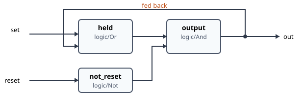

# 14. Design patterns

Small arrangements of blocks that solve problems you meet in every plant. Each is used in the
examples. Where hakkas works differently from a PLC, the pattern says why.

## 14.1 Choosing between signals

**Choose between two values by a condition**: `process/SelectIn`. `output` is `in_true` while
`select` is true, else `in_false`. Used for:
- the thermostat's setpoint, 21 or 17 °C (Section 4.8);
- the heat exchanger's 100 % or 0 % by the fans (Section 13.6).

**Add an offset by a condition**: a `SelectIn` choosing between 0 and the offset, then a
`math/Add2`. Used for the heating circuit's night setback (Section 12.2).

**Choose one of up to eight**: `process/MultiplexIn`, with `select` 1–8. For example, a mode
selector: 1 comfort, 2 economy, 3 frost guard.

**Route one value to one of several places**: `process/SelectOut` (two) or
`process/MultiplexOut` (eight). The outputs not chosen are 0, not their last value, so a
downstream actuator never keeps running on a stale value.

**The larger or the smaller of several**: `math/Max` and `math/Min`. Used where two regulators
share an actuator and the one asking more must win, as frost protection and the supply air both
drive the heating valve (Section 13.6). Only the inputs that are fed count.

**A manual override**: `process/AutoMan`. `override` makes `output` follow `manual` instead of
`input`. The output jumps when switched. For a regulator, use the PID's own `auto` and `manual`
instead: that switch is bumpless.

::: tip Coming from IEC 61131-3
`SelectIn` is `SEL`, `MultiplexIn` is `MUX` counting from 1, and `math/Max` and `math/Min` are
`MAX` and `MIN`, except that unconnected inputs do not count.
:::

## 14.2 Latches

**Set and reset by edges**: `process/Trigger`. A rising `fire` sets `output`, and a rising `arm`
clears it. Only edges count, so a held button acts once. It is the latch of Extended operation
(Section 13.3).

**Set and reset by levels**, an SR flip-flop: a `logic/Or` fed back through a `logic/And`,
with reset winning:

This is a feedback loop: the `And`'s output goes back to the `Or`. Section 14.8 explains when such a
loop is safe. This one is safe, since each block changes only once per change of `set` or `reset`.

**A latch held by an alarm**: often what needs latching is "until a person has acknowledged".
`process/Alarm` is such a latch, with proper states. The air handling unit's frost lock is the
alarm not being *Normal* (Section 13.7).

::: tip Coming from IEC 61131-3
There are no `SR`/`RS` blocks: `process/Trigger` is the edge-triggered latch. `R_TRIG`/`F_TRIG`
are rarely needed, since only changes travel. A block that acts on a rising edge, such as
`Trigger`, `Alarm`'s `acknowledge` or a calendar boundary, does so itself.
:::

## 14.3 Timers

| PLC timer | In hakkas |
|---|---|
| on-delay `TON` | `process/Delay` with `mode` 1: on waits, off passes at once |
| off-delay `TOF` | `process/Delay` with `mode` 2: off waits, on passes at once |
| on- and off-delay together | `process/Delay` with `mode` 0, its resting value: `output` takes `input` once it has been stable for `milliseconds` |
| pulse `TP` (a fixed-length pulse) | `process/Trigger` fired by the input, armed by a `process/Delay` of its own output (the pattern of Section 13.3) |
| a pulse train, a blinker | `timing/Interval`: a period and a duty cycle |
| a debounce | `process/Delay` of a few hundred ms: a shorter pulse never comes through |
| running hours | `process/Integrator` of the running signal (1 while true), `divisor` 3600 |

**Times in units**: a `process/Delay` and a `timing/Interval` take milliseconds. `timing/Days`,
`timing/Hours`, `timing/Minutes` and `timing/Seconds` convert, so a process reads as it is
meant: `3 → Hours → Delay`.

A `process/Delay`'s time and mode can be changed while it waits, and the change applies to the
running wait. The AHU uses that to end Extended operation and reset at once (Section 13.3).

Timers run on the controller's clock and survive nothing: a stop or a restart starts them from
zero (14.7).

## 14.4 Schedules and calendars

Schedules are built from **calendar blocks**, each true while the current time matches its
setting, joined by logic:

| Block | Setting | Example |
|---|---|---|
| `timing/MinuteRange` | `HH:MM-HH:MM` | `06:00-18:00`, or `22:00-06:00` over midnight |
| `timing/DayOfWeek` | days 1–7, Monday = 1 | `1-5` workdays, `6,7` weekends |
| `timing/DayOfMonth` | days 1–31 | `1` the first of each month |
| `timing/MonthOfYear` | months 1–12 | `10-4` October to April |
| `timing/DayOfYear` | days 1–366 | |
| `timing/WeekOfYear` | ISO weeks 1–53 | `28-31` the summer holiday |

Settings are lists and ranges: `1-3,5`, and a range may wrap: `6-1` is Saturday to Monday.

**A week schedule** is a `MinuteRange` **and** a `DayOfWeek` (the thermostat, Section 4.8). The
standard library has it, and the day, month and year schedules, as composite types
(`schedule/WeekSchedule`, …; Chapter 16 installs it).

**Several periods a day**: one `MinuteRange` per period, joined by `logic/Or`.

**Dates** (15 September – 15 May): whole months, plus the parts of the first and last month, as
the AHU's seasons do (Section 13.4).

**Exceptions**, such as holidays: a `DayOfYear` or `WeekOfYear` with the exception days, used to
switch the schedule off through a `logic/And` with a `logic/Not`. Holidays that move, such as
Easter, need their days updated each year.

The blocks use the controller's local time, from its time-zone setting, including daylight
saving time (Section 16.2). They wake exactly at their boundaries, and nothing polls.

## 14.5 Scaling to and from volts

Keep the process in engineering units, and convert at the edges with `process/Linear`
(`out = k·in + m`):

| Signal | `k` | `m` |
|---|---|---|
| 0–100 % to 0–10 V | 0.1 | 0 |
| 0–100 % to 2–10 V | 0.08 | 2 |
| 0–10 V from a sensor of −50…+50 °C | 10 | −50 |
| 4–20 mA from a sensor of 0…10 bar | 0.625 | −2.5 |

A regulator then works in percent, and only the scaling knows the valve's signal. Put the scaling
next to the binding, so that the process reads in units.

For a non-linear sensor, use `process/Curve` with up to seven points from its data sheet.

## 14.6 Alarm handling

`process/Alarm` follows a **condition**: a bool, true while the alarmed situation exists. It
keeps the alarm's state until a person acknowledges it:

- *Activated* when the condition comes;
- *Deactivated* when it goes, unacknowledged;
- *Acknowledged* when acknowledged while it still holds;
- back to *Normal* when both have happened;
- *Reactivated* when it comes back unacknowledged.

**Good conditions**:
- **Delay them.** A `process/Delay` with `mode` 1 before the alarm keeps a passing deviation
  from raising it, and lets the alarm go as soon as the condition does. For a slow process the
  wait is long: `2 → Hours → Delay` before "the room has not reached its setpoint". The AHU's
  frost waits 5 s, with both edges delayed.
- **Alarm on goals, not on components**: the temperature that is not reached, rather than every
  status contact (Section 13.12).
- **Give it a class**:
  - A: attend to at once, day and night;
  - B: during working hours;
  - C: soon;
  - D: of interest only.

  Give it a `category` (the unit's name), so that alarm views can sort them.
- **Use the states.** A function that must wait for acknowledgement uses the alarm's outputs. The
  AHU's frost lock is "not *Normal*".
- **Fluttering**: an alarm that comes and goes all the time can be **blocked** for a while
  (`block`); one that must not raise at all is **disabled** (`disable`).

Acknowledging is a rising edge on `acknowledge`: a button on the unit, or an input set from
elsewhere.

## 14.7 Start-up behaviour

A process that starts, whether because you started it or because the controller restarted
after a power cut, starts **afresh**:

- **Every block computes once** from its inputs as they are, and sends all its outputs. Then the
  values travel as usual.
- **Sensors deliver a moment later.** Until then, a bound input holds its resting value: 0 °C for
  a temperature.
- **Nothing is remembered**: timers start from zero, integrals from their manual values, latches
  and alarms from off. There are no retained variables.

Patterns for it:

- **A start delay for regulators.** A PID that goes to automatic before its measurement has
  arrived presets its integral from a bogus error. Give it a start delay:
  1. A fixed value `true` into a `process/Delay` with `mode` 1, its time from
     `10 → Seconds`.
  2. A `logic/And` of the delay's output and the regulator's other conditions, into `auto`.

  In `mode` 1 a `Delay` starts with its output false, and a true input waits the full time,
  also one that is there at the start. In `mode` 0 it takes its input at once at the start, so
  there a fixed `true` would pass at once (Section 12.5).
- **Confirm conditions that a missing value can fake.** A frost alarm on "below 5 °C" fires at
  the start on the sensor's resting 0 °C. A delay before it avoids that (Section 13.8). With
  `mode` 1 even a condition that is true at the start waits.
- **Count on a safe resting state.** Every input rests at 0 or false, and the block types are
  designed so that rest means off: a regulator in manual at 0, a schedule off, a pump off. A
  process with a missing connection does nothing, rather than something wrong.
- **Stopping keeps the outputs.** A stopped process does not switch its actuators off. If an
  actuator must be off during maintenance, switch it off from within the process, for example
  with a maintenance switch on the operator's panel, and then stop.
- **Remembering across restarts** is not possible yet. A value that must survive, such as a
  counter or a setpoint changed by an operator, belongs in a fixed value that is saved with the
  process.

::: tip Coming from IEC 61131-3
There is no warm start and no `RETAIN`: every start is a cold start. Design the process so that a
cold start is safe, which the resting values make the natural case.
:::

## 14.8 Ordering in feedback loops

All changes go through one queue and are worked off in the order they arise (Section 2.2).
Without feedback the order does not matter: each block computes when an input changes, and the
last change it sees wins.

**With feedback**, where a block's output comes back to one of its own inputs through other
blocks, the order can matter:

- **A loop that settles**, like the SR latch of 14.2, is safe. Each change travels round once,
  and the blocks then hold.
- **A loop that never settles**, such as a `logic/Not` fed by its own output, oscillates as fast as
  the queue can work it off. It does not deadlock, but it keeps the controller busy. Break every
  such loop with something that holds: a `process/Delay`, a `process/Trigger`, or a timer.
- **A loop whose result depends on which of two changes arrives first** is a design error. The
  usual case is two paths from one change that meet again in one block, which then computes
  twice: once with the new value from the short path and the old one from the long path, then
  with both new. The intermediate output travels on. If that matters, for example to a latch,
  delay or confirm the result, or rework the logic so that one path decides.

The AHU's Extended operation is a loop that settles. The timer's own output changes its time,
and when it turns true the time becomes 0, so the timer follows its input back at once
(Section 13.3).

::: tip Coming from IEC 61131-3
A PLC evaluates a network once per cycle in a fixed order, and a feedback variable is read with
last cycle's value. In hakkas every change propagates at once and completely, so a loop runs
until it settles, not once per cycle.
:::
