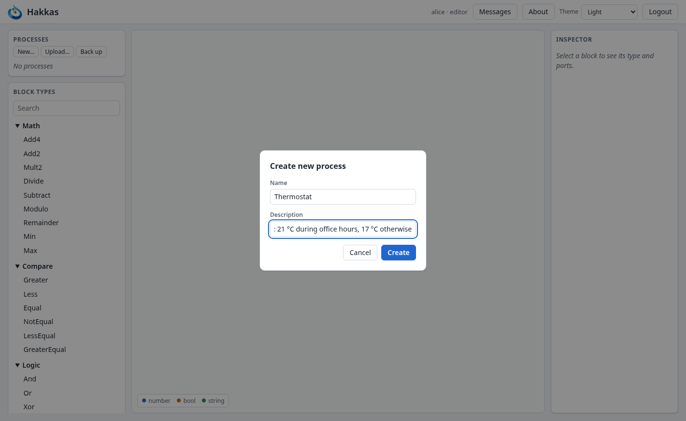
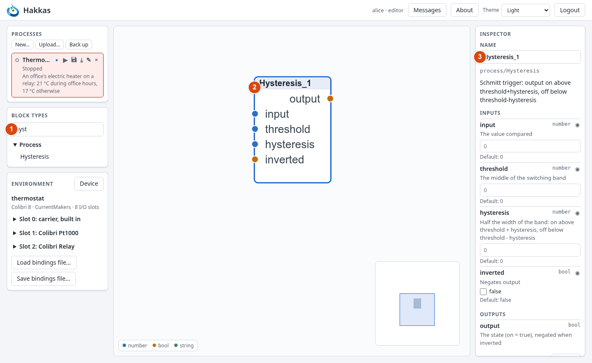
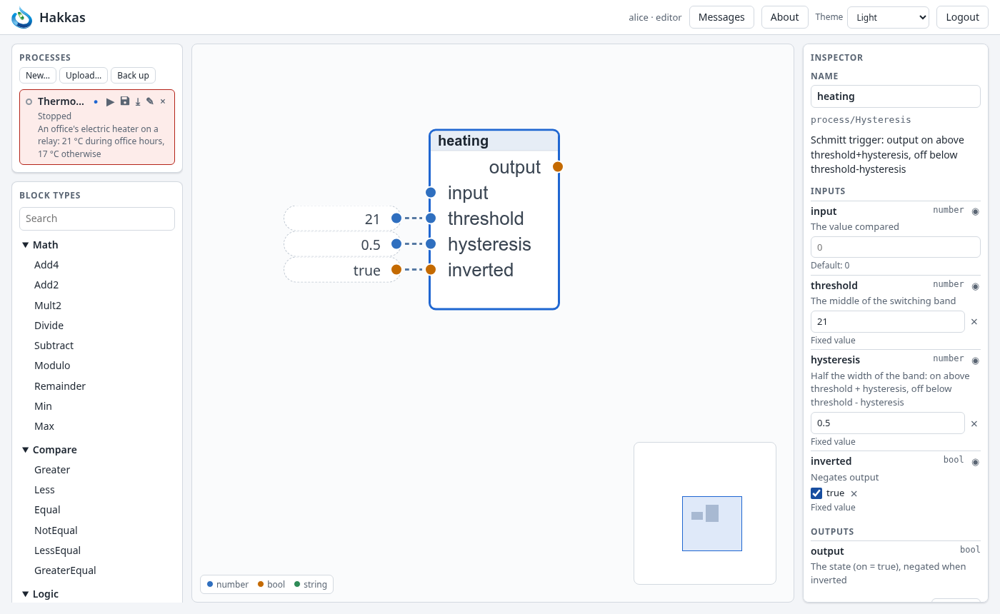
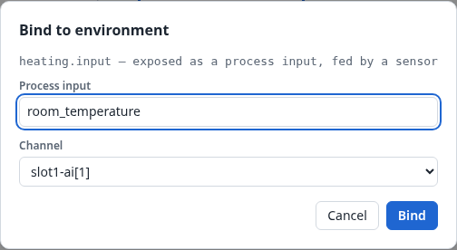
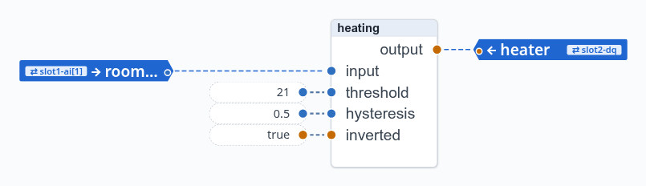
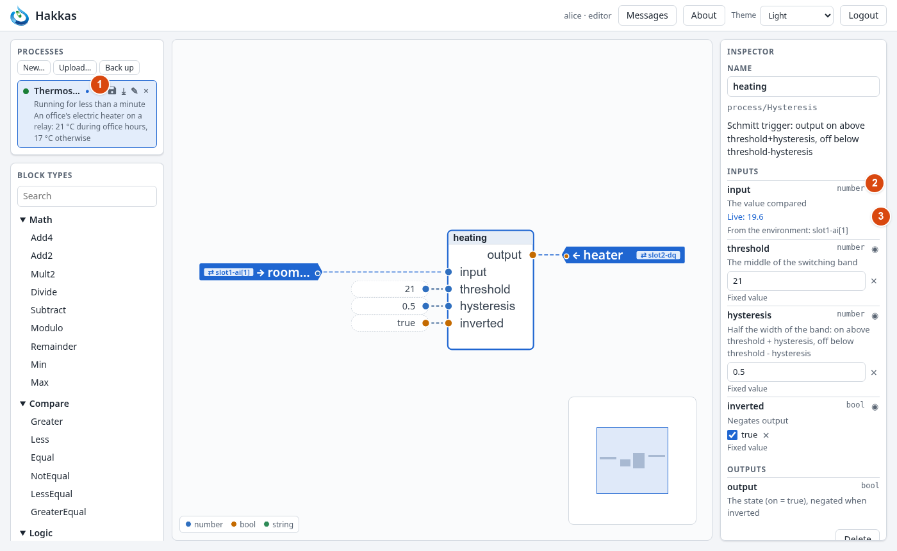
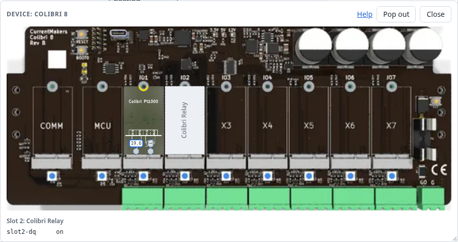
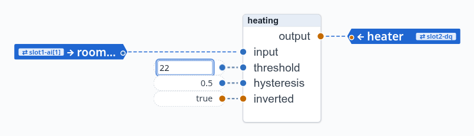
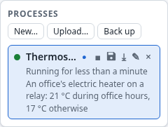
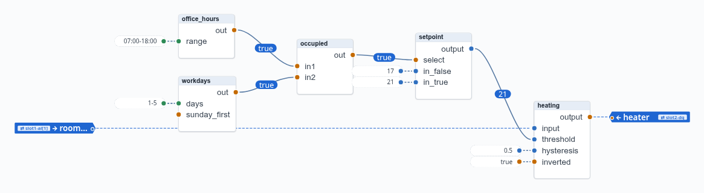

# 4. Building the thermostat

This chapter builds a complete, small control program: a thermostat for an office's electric
heater. It is done in two stages. First a plain thermostat holds the room at 21 °C. Then a
schedule lowers the setpoint to 17 °C outside office hours.

Along the way you use most of what you will use every day: adding blocks, setting values,
binding to the I/O, starting, watching, changing a running process, saving and undoing.

**The hardware.** The thermostat runs on a Colibri 8 with two modules: a Pt1000 module in slot 1
for the room sensor, and a relay module in slot 2 for the heater's contactor.

| Channel | Module | What |
|---|---|---|
| `slot1-ai[1]` | Pt1000, input 1 | the room temperature, °C |
| `slot2-dq` | Relay (one channel, so no index) | the heater, on or off |

You don't need the hardware. The example's environment file,
`examples/thermostat/thermostat.json`, gives you the same controller in the Colibri emulator, and
Appendix D shows how to start the two. In the emulator's own page you set the room temperature by
hand and watch the relay.

::: tip The finished example
`examples/thermostat/Thermostat.process.json` is the thermostat as this chapter ends, with its
bindings. You can upload it with *Upload…* (Chapter 9) instead of building it. But build it once
yourself: it is the quickest way to learn the editor.
:::

## 4.1 Creating the process

In the process list, choose *New…*. Give the process a name and a short description, and
choose *Create*.

The new process opens in the editor. It is empty and **stopped**: the list shows it with a grey
dot and a red tint, so that a stopped process is noticed.

The name is for people: you can change it at any time (a double-click on it in the list). The
controller identifies the process by an id of its own, which you never need to type.

## 4.2 Adding blocks and connecting them

A thermostat is a comparator with hysteresis: it switches the heater on when the room is too
cold, and off when it is warm enough. A band between the two keeps the heater from switching on
and off at every small change. The block type for this is `process/Hysteresis`:

| Port | | What |
|---|---|---|
| `input` | number in | the value compared: the room temperature |
| `threshold` | number in | the middle of the band: the setpoint |
| `hysteresis` | number in | half the band's width |
| `inverted` | bool in | turns the output around |
| `output` | bool out | on above `threshold + hysteresis`, off below `threshold − hysteresis`; unchanged in between |

To add it, type `hyst` in the search field of *Block types* ①. Then drag *Hysteresis* onto the
canvas, or click it to add it in the middle of the view.

The block ② shows its outputs at the top right and its inputs below on the left. Each port has a
colored socket: blue for number, orange for bool, green for string (the legend in the editor's
corner says so).

Hakkas named the block `Hysteresis_1`. Rename it to `heating` in the inspector's *Name* field ③,
and press Enter. You can also press F2, or choose *Rename* in the block's context menu.

**Connecting** two blocks is a drag from an output's socket to an input's socket. The thermostat
has only one block for now; you draw its first connection in 4.8. An input takes one connection
only. To move a connection, drag its end off the input and onto another; to remove it, drag it off
and drop it on the empty canvas.

::: tip Coming from IEC 61131-3
There is no execution order to arrange and nothing to declare: the block exists, with its
inputs at their resting values, as soon as it is on the canvas.
:::

## 4.3 Setting values

The thermostat should hold 21 °C with a band of ±0.5 °C. Since the heater must be **on** when the
room is **below** the band, the comparator's output is turned around: `inverted` is true.

With the block selected, the inspector lists its inputs, each with an editor for its value.
Type `21` for `threshold` and press Enter, then `0.5` for `hysteresis`. Tick the box for
`inverted`.

Each value appears as a **value node** beside its input, joined to it by a dashed line, and the
inspector says *Fixed value*. An input without a value shows *Default*: the resting value of its
type, here 0 or false (Section 2.3).

Two other ways to set a value, often quicker on the canvas:

- Drag a line out of a free input and drop it on the empty canvas: a small box asks for the value.
- Right-click the input and choose *Set fixed value…*.

The heater now switches on below 20.5 °C and off above 21.5 °C.

## 4.4 Process ports, and binding them to the I/O

The block's `input` must get the room temperature, and its `output` must drive the relay. Both
go through **process ports** (Section 2.5): `input` becomes the process input
`room_temperature`, bound to the sensor channel `slot1-ai[1]`.

Right-click the `input` row of the block and choose *Bind to environment…*. Since no process port
exposes the input yet, the dialog makes one. Name it `room_temperature`, choose the channel
`slot1-ai[1]`, and choose *Bind*.

The dialog lists only the channels that fit: sensors for an input, actuators for an output. An
actuator that another process already drives is listed but cannot be chosen, since each actuator
has one driver.

Do the same for the `output` row: name the process output `heater` and choose `slot2-dq`.

The process ports are drawn as markers at the process's edges: inputs on the left, outputs on the
right. A bound marker shows its channel (`⇄ slot1-ai[1]`), and its line to the block is dashed. In
the *Environment* panel, the two channels now say what they are bound to.

A process port can also be made without binding it: *Expose as process input…* in the input's
menu. That is the way for a port that another process will feed, or one you bind later on another
controller (Chapter 9).

## 4.5 Starting it and watching live values

Choose ▶ (*Start*) on the process in the list ①. The dot turns green and the list says how long it
has been running. Starting runs every block once, so the heater is switched at once by the
current room temperature. It does not wait for the temperature to change.

**Watching values.** Nothing is shown live until you ask for it, so that a large process does
not flood your browser. In the inspector, the ◉ button beside an input ② watches it. Its live
value appears below it ③, here the room temperature from the sensor: 19.6 °C.

Other ways to watch:

- Right-click a connection or an input and choose *Watch value*.
- Right-click a block and choose *Watch inputs*.
- Right-click the canvas and choose *Watch all connections*: every connection shows its value in
  the middle of its line (see 4.8).

**The device window.** *Device* in the Environment panel shows the controller as it is, with the
live value of every channel. It is a floating window that you can resize or pop out into a window
of its own (Section 8.2). Here the Pt1000 module reads 19.6 °C, and the relay in slot 2 is on.

With the emulator, change the room temperature in its page and watch the relay follow:
- It stays on up to 21.5 °C, then switches off.
- It stays off down to 20.5 °C, then switches on again.

## 4.6 Changing the setpoint while it runs

Double-click the value node `21`, type `22` and press Enter.

The change takes effect at once, in the running process: the block computes with its new
`threshold` as soon as the value arrives. There is nothing to download and no restart.

That is true for every edit. A block added to a running process starts immediately, and a
connection removed takes effect at once (the input returns to its resting value). That is
powerful, and on a real plant it calls for care: think before you delete the connection to an
actuator's block.

::: tip Coming from IEC 61131-3
This is an online change, but there is no separate offline program to keep in step: what the
editor shows is what runs.
:::

## 4.7 Saving, and what "unsaved" means

Every change so far lives in the controller's memory. It works, but it would be lost if the
controller restarted. The process list marks the process with a dot ● for unsaved changes.

Choose the save button in the process's row, or press Ctrl+S while it is open. A short notice says
*Saved “Thermostat”*, and the mark goes away. Saving writes:

- the process: its blocks, connections, values and ports;
- its bindings;
- whether it is **running**. A process saved while running starts by itself when the controller
  starts, for example after a power cut. One saved while stopped stays stopped.

Starting or stopping a process therefore also marks it unsaved, until you save the new state.

## 4.8 Adding the schedule

The office is empty at night and over the weekend, so the setpoint should drop to 17 °C there.
That needs three things: a clock that says whether it is office hours, a choice between two
setpoints, and a connection to `heating.threshold`. Add these blocks, rename them and give them
their values as before:

| Block | Type | Values | What it does |
|---|---|---|---|
| `office_hours` | `timing/MinuteRange` | `range` = `07:00-18:00` | true from 07:00 until 18:00 |
| `workdays` | `timing/DayOfWeek` | `days` = `1-5` | true Monday (1) to Friday (5) |
| `occupied` | `logic/And` | | true when both are |
| `setpoint` | `process/SelectIn` | `in_true` = 21, `in_false` = 17 | `output` is `in_true` while `select` is true, else `in_false` |

Then connect them:
- `office_hours.out` → `occupied.in1`;
- `workdays.out` → `occupied.in2`;
- `occupied.out` → `setpoint.select`.

Finally, drag a connection from `setpoint.output` to `heating.threshold`. The input already has
the fixed value 22, and the new connection **replaces** it: an input has one source, and the
editor removes the value first. (Undo brings both back as they were.)

With *Watch all connections* on (the canvas's menu), each line shows its value: it is office
hours on a workday, so the setpoint is 21.

A few things worth knowing about these blocks:

- **The calendar blocks** use the controller's local time, set by its time zone (Chapter 16).
  They do not poll: each one wakes exactly when its range starts or ends, and its output changes
  then.
- **Settings are inputs.** `07:00-18:00` and `1-5` are fixed values like any other. You can
  change them while the process runs, or feed them from elsewhere.
- **Ready-made schedules.** The standard library has composite types such as
  `schedule/WeekSchedule`, which are `MinuteRange` and `DayOfWeek` joined by an `And` in one block.
  An administrator installs it (Chapter 16). The thermostat uses the parts so that you can see them.
- **Placement** is yours. *Arrange blocks* in the canvas's menu lays the process out
  automatically, from left to right.

::: tip Coming from IEC 61131-3
`process/SelectIn` is the standard `SEL` function: `in_false` is `IN0`, `in_true` is `IN1`.
:::

Save the process: the thermostat is finished.

## 4.9 Undo, and what it cannot undo

Ctrl+Z undoes your last edit, and Ctrl+Shift+Z (or Ctrl+Y) redoes it. Try it on the last
connection: Ctrl+Z removes it and brings the fixed value 22 back; Ctrl+Shift+Z makes it again.

What you can undo:

- **Edits of the open process:** blocks added, removed, renamed and moved; connections; values;
  process ports; bindings. A deleted block comes back where it was, with its connections, values,
  ports and bindings.
- **One action, one step.** What you did in one action is undone as one step: a deleted
  selection, a paste, a drag of several blocks, a port made and bound in one dialog.
- **Over a reload.** The history is kept for each process, for as long as the browser tab is
  open, also over a reload of the page.

What you cannot undo:

- **Starting, stopping, saving, creating and deleting processes.** A deleted process is gone,
  which is why hakkas asks first.
- **Someone else's edits.** Each browser tab undoes only its own. If someone has since changed
  what your step would undo, hakkas skips it and says *Not undone: changed since by someone
  else*. The next Ctrl+Z goes on with the step before.

The next part, Chapters 5 to 11, describes each part of hakkas in full, starting with the editor.
