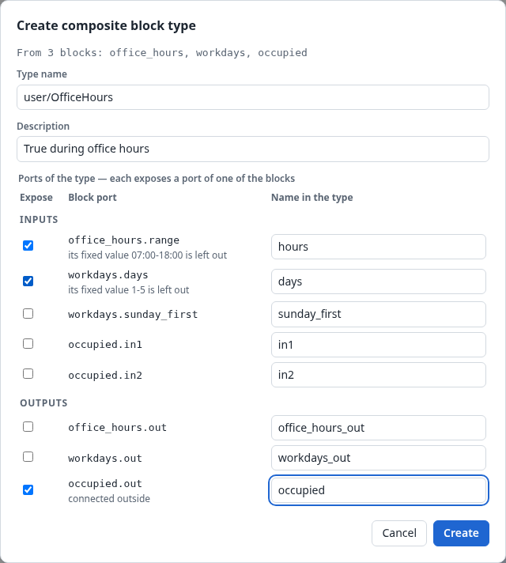
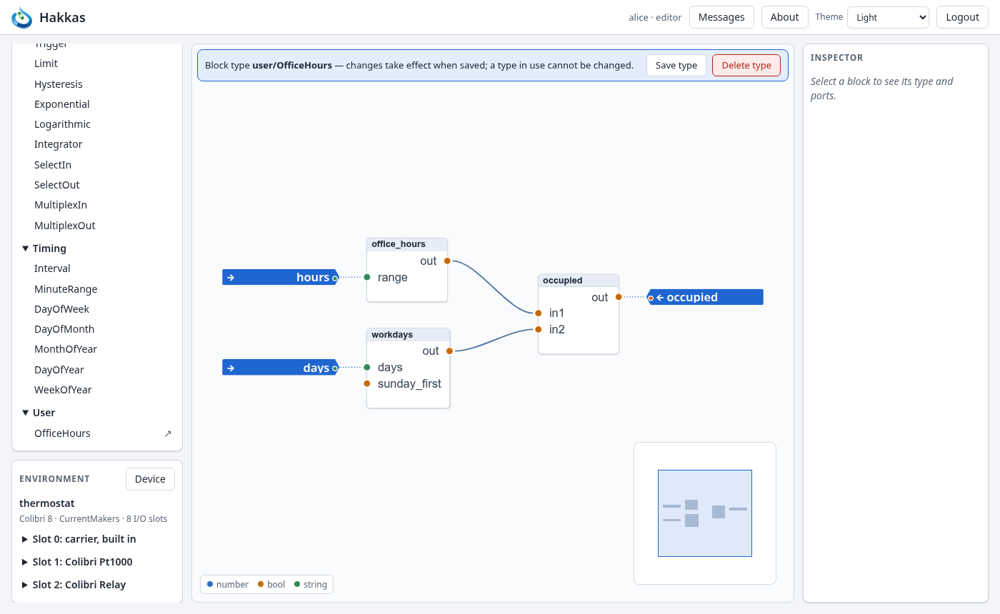

# 7. Composite block types

A composite block type is a block type of your own, made of other blocks (Section 2.6). Once
made, it is in the palette like any built-in type. Each block of it runs its own copy of the
blocks inside, at the same speed as if they were placed in the process directly.

Use one when a group of blocks does one recognizable job that you need more than once, or that
makes a large process easier to read: an office-hours clock, a pump with its weekly exercise,
frost protection. Chapter 13 makes some out of the air handling unit.

## 7.1 Creating one from a selection

Select the blocks (Section 5.2), right-click one of them or the canvas, and choose *Create
composite type…*. The example below makes the thermostat's office-hours clock, three blocks, into
a type.

The dialog asks for:

- **A type name**, `family/Name`, such as `user/OfficeHours` or `ahu/FrostProtection`:
  - Both parts may have letters, digits, `-` and `_`, at most 64 characters in all.
  - The family becomes the type's group in the palette.
  - The name must not be taken, by a built-in type or another composite type.
- **A description**, shown in the palette's tooltip and in the inspector.
- **The type's ports.** Every input and output of the selected blocks is a row, which you tick to
  make it a port of the type, under the name in the right column. Hakkas ticks some to begin
  with:
  - inputs fed by a connection from outside the selection;
  - outputs with a connection to outside it (*connected outside*);
  - block ports that are process ports.

  Tick or untick any others, and rename them to what they mean to whoever uses the type. Here
  `office_hours.range` and `workdays.days` are ticked and named `hours` and `days`, so that each
  block of the type can have its own hours.

**Fixed values.** A fixed value inside the selection becomes part of the type, and is the same
in every block of it. An input that becomes a port of the type is fed from outside instead, so
its fixed value is **left out**, as the dialog says (*its fixed value 07:00-18:00 is left out*).
Set it on each block of the new type.

*Create* registers the type and saves it on the controller. It appears in the palette under its
family. The selected blocks stay as they were: replace them by a block of the new type yourself,
if you want to.

## 7.2 Looking inside, and editing

A composite type's palette entry has an ↗ button that opens the type's inside in the editor, like
a process. A banner names the type, and its ports are drawn as process port markers.

You can edit the inside like a process: add blocks, connect them, change values, add or remove
ports. The changes take effect when you choose **Save type**, which replaces the type. **Delete
type** removes it, after asking.

**A type in use cannot be changed or deleted.** A type is in use while any process has a block
of it, or another composite type contains it. *Save type* and *Delete type* are then refused with
*Component in use*. To change a type that is in use, there are two ways:

- Remove its blocks, save the type, and put them back.
- Make the changed version under a new name, for example `user/OfficeHours2`, and replace the
  blocks one by one.

The second way lets the old blocks run until you replace them.

Renaming a type and changing its description from the editor are not possible yet.

## 7.3 Its ports

A composite type's ports behave exactly like a built-in type's:

- **An input** of the type is an input of a block inside. A connection to it, or a fixed value on
  it, feeds that inner input directly. An input fed by nothing rests at the inner input's resting
  value.
- **An output** of the type is an output of a block inside. It can be exposed under several names,
  but one inner input can be fed by only one type input.
- **Types** come from the inner ports: a port is a number, a bool or a text as the inner port is.

There is no extra step between the outside and the inside: a value reaches the inner block as
quickly as if the blocks were in the process directly. Each block inside computes on change as
always (Section 2.2).

## 7.4 Nesting, and the "in use" rules

A composite type may contain blocks of other composite types, to any depth. The palette shows a
type only once it exists, so build from the inside out: first the small types, then the types
that use them.

The rules:

- **No recursion.** A type cannot contain itself, directly or through another type.
- **One source per input**, inside as outside.
- **In use means unchangeable.** This protects running processes from a change under their feet:
  a type's blocks keep behaving as they did when they were placed.

The blocks inside a block of a composite type are not part of the process: they are not shown
or selected in the process, and their names cannot clash with the process's own. To see their
values, open the type (↗). Watching inside a running block is not possible yet.

## 7.5 Type libraries

Composite types are kept on the controller, one file per type, and are shared by all its
processes. They travel:

- **with a process**: downloading a process includes every composite type it uses, and the types
  those use (Chapter 9);
- **in a backup**: every composite type on the controller;
- **as type files**: a library of ready-made types, such as the standard library
  `library/schedules/` (`schedule/DaySchedule`, `WeekSchedule`, `MonthSchedule`,
  `YearSchedule`), can be uploaded with *Upload…* (Section 9.2) or installed by an
  administrator (Chapter 16).

When a type of the same name is already on the controller, an upload keeps the controller's
version and says so. It never overwrites a type that a running process may use.
