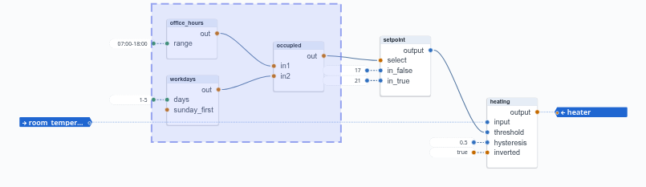
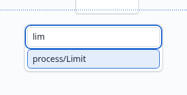
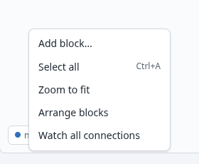
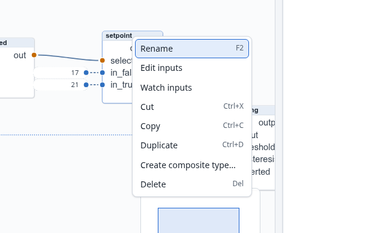
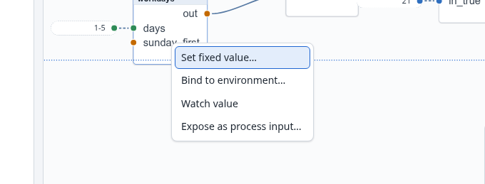

# 5. The process editor

The editor is the canvas in the middle of the screen. It shows the open process: its blocks,
their connections, the fixed values beside their inputs, and the process ports at its edges. This
chapter describes everything you can do in it. Chapter 4 showed the same things in use.

**Everything goes through the controller.** Every edit is a request to the controller, which
applies it and tells every browser what changed. Only then does the editor draw the change
(Section 2.7). On a normal network you will not notice. If the controller refuses an edit, the
editor stays as it was and shows the controller's message, for example *Node exists: heating*
when the name is taken.

## 5.1 Moving around: pan, zoom, minimap

| To | Do |
|---|---|
| pan | drag with the **right** mouse button, or scroll with the wheel (Shift+wheel scrolls sideways) |
| zoom | Ctrl+wheel at the pointer, or pinch on a trackpad; a double-click on the canvas zooms in |
| see everything | *Zoom to fit* in the canvas's context menu |
| find your way | the **minimap** in the corner shows the whole process and the part in view |

A process zooms to fit when you open it. On a touch screen, drag with one finger to pan and pinch
to zoom.

A right-click that does not move opens the context menu instead (5.3). The menu opens when you
release the button, so a right drag never opens it.

## 5.2 Selecting

| To | Do |
|---|---|
| select one block | click it |
| add a block to the selection, or remove it | Ctrl+click or Shift+click (⌘ on a Mac) |
| select an area | drag on the empty canvas: every block whose middle is inside the rectangle |
| add an area | Shift+drag (or Ctrl+drag) |
| select everything | Ctrl+A |
| select nothing | Escape, or a click on the empty canvas |

Dragging a selected block moves the whole selection. Delete (or Backspace) removes the selected
blocks with their connections, values and process ports.

Your selection is your own: other people looking at the process do not see it.

## 5.3 Adding blocks, and the context menus

**From the palette.** The *Block types* panel lists every type by family:
- *Math*, *Compare*, *Logic*, *Process* and *Timing* for the built-in types;
- one family for each group of composite types, such as *User*.

Point at a type for its description and its ports. Type in the search field to find one by name.
Click a type to add a block in the middle of the view, or drag it to where you want it.

**From the canvas.** Right-click the empty canvas and choose *Add block…*. Type part of the
name, then choose with the arrow keys and Enter, or with a click. The block lands where you
right-clicked.

Search matches the part of the name after the family, ignoring case. Names that **start** with
what you type come first, then names that contain it: `lim` finds *Limit*.

A new block is named after its type with a number, such as `Limit_1` or `Limit_2`. Rename it to say
what it does (5.7).

**The context menus.** A right-click offers what fits what you clicked. The canvas:

- *Add block…*;
- *Paste here*, when you have copied something (5.8);
- *Select all*, *Zoom to fit*, *Arrange blocks* (5.9);
- *Create composite type…*, when blocks are selected (Chapter 7);
- *Watch all connections* (5.11).

A block:

- *Rename*;
- *Edit inputs* (the block's first input in the inspector);
- *Watch inputs*;
- *Cut*, *Copy*, *Duplicate*;
- *Create composite type…*;
- *Delete*.

With several blocks selected, the items apply to all of them (*Delete 3 blocks*).

An input, by a right-click on its row in the block:

| The input has | The menu offers |
|---|---|
| nothing | *Set fixed value…*; *Bind to environment…* (Chapter 8); *Watch value*; *Expose as process input…* |
| a fixed value | *Change fixed value…*; *Use the default*; *Watch value*; *Expose as process input…* |
| a connection | *Disconnect*; *Watch value*; *Expose as process input…* |
| a binding | *Unbind from …*; *Watch value*; *Expose as process input…* |

There are menus for other parts too:
- **an output:** *Bind to environment…*, *Unbind from …*, *Expose as process output…*;
- **a connection:** *Delete connection*, *Watch value*;
- **a value node:** *Change value…*, *Remove value*, *Watch value*;
- **a process port's marker:** see 5.12.

**From the keyboard.** The menu key, or Shift+F10, opens the menu of the selected block, or the
canvas's menu when nothing is selected. Then:
- the arrow keys, Home and End move through the menu;
- Enter chooses;
- Escape closes it.

## 5.4 Connections

To connect, drag from an output's socket to an input's socket. A connection always runs from an
output to an input.

- **An output feeds any number of inputs.**
- **An input has one source:**
  - Drawing a connection onto an input that already has one replaces it.
  - Drawing one onto an input with a fixed value replaces the value. The editor removes the value
    first, and an undo brings it back.
- **To remove a connection**, drag its end off the input and drop it on the empty canvas. Or
  right-click it and choose *Delete connection*, or right-click the input and choose
  *Disconnect*. The input returns to its resting value at once.
- **Types convert.** You can connect a bool output to a number input (it arrives as 0 or 1) and
  the other way round (not 0 is true). The sockets' colors show the types, so that a conversion
  is a choice, not an accident.

A connection is drawn as a curve from socket to socket; it cannot be routed by hand yet. If the
curves of a large process tangle, move the blocks: placing them so the signal reads
from left to right untangles most of it.

## 5.5 Values on inputs

A **fixed value** is an input's constant. It is drawn as a value node beside its input. Ways to
set one:

- type it into the input's field in the inspector (5.6) and press Enter;
- drag a line out of a free input and drop it on the empty canvas: a box asks for the value
  (true/false buttons for a bool);
- choose *Set fixed value…* in the input's context menu.

To **change** a value, double-click its node (a bool toggles), or edit it in the inspector.
Enter sends the value, and Escape keeps the old one. A number field takes only a number: `4.2 V`
is refused with *Enter a number*.

To **remove** a value, drag its line off the input and drop it on the canvas. Or choose *Remove
value* in its menu, or *Use the default* in the input's. The input returns to its resting value.

To **move** a value to another input, drag its line from one input to the other. To **copy** it,
draw a line from the value node to the other input.

Value nodes are not blocks: you cannot select or move them, as they follow their block.

## 5.6 The inspector

The panel on the right shows what is selected.

**With one block selected:**
- its name, which you can change there (5.7);
- its type and the type's description;
- every input, with its type and description and what feeds it:
  - *Connected from setpoint.output*;
  - a fixed value in an editor that fits the type (a field for a number or a text, a box to tick
    for a bool);
  - *From the environment: slot1-ai[1]* for a bound input;
  - *Default: 0*, the resting value, with an empty field to set a value;
- every output, with its type and description;
- *Delete*.

Each input has a ◉ button that watches its live value (5.11).

**With several blocks selected**, it shows how many there are and their names. **With nothing
selected**, it says to select a block.

For a viewer the inspector is read-only, but it shows the same things.

## 5.7 Renaming

A block's name must be unique within its process. Rename a block:
- in the inspector's *Name* field (Enter, or leaving the field, sends it; Escape keeps the old
  name);
- with F2;
- with *Rename* in the block's menu.

If the controller refuses the name, the reason appears under the field.

Renaming changes nothing else: the block keeps its connections, values, ports and bindings, and
watched values go on.

## 5.8 Cut, copy and paste

| Keys | Menu | What |
|---|---|---|
| Ctrl+C | *Copy* | copies the selected blocks |
| Ctrl+X | *Cut* | copies them, then removes them (one undo step brings them back) |
| Ctrl+V | *Paste here* (where you right-clicked) | pastes, 40 pixels right of and below where they were copied from; each further paste one step further |
| Ctrl+D | *Duplicate* | pastes the selection beside itself, without touching the clipboard |

**What is copied:**
- the blocks, with their types, positions and fixed values;
- the connections **between** them.

Connections to blocks outside the selection are not copied, and neither are process ports or
bindings.

**Where you can paste:** into any process, also on another controller. The copy goes to your
computer's clipboard as text, so you can copy in one browser tab and paste in another. Pasted
blocks keep their names when those are free, or get the next free number (`heating` becomes
`heating_1`). They become the selection.

## 5.9 Arranging blocks

*Arrange blocks* in the canvas's menu lays out the whole process automatically, its signals
running from left to right. Each block's new position goes to the controller like a move by
hand, so one Ctrl+Z puts every block back.

The layout takes a moment the first time: its code loads only when you use it.

## 5.10 Undo and redo

| Keys | What |
|---|---|
| Ctrl+Z (⌘Z) | undo |
| Ctrl+Shift+Z or Ctrl+Y | redo |

**What can be undone.** Your own edits of the open process, each action one step:
- blocks added, removed, renamed and moved (a drag is one step);
- connections, values and process ports;
- bindings, and a loaded bindings file.

Undoing a deletion brings everything back: the block, its connections, values, ports and
bindings.

**Kept** per process, the last 500 steps, as long as the browser tab is open, also over a reload.
Another tab has a history of its own.

**Not undone:**
- starting, stopping and saving;
- creating, deleting, uploading and replacing processes;
- creating composite types;
- other people's edits.

**Checked first.** If someone else has changed what a step would undo, the step is skipped with
the message *Not undone: changed since by someone else*. The next Ctrl+Z goes on with the step
before.

In a text field, Ctrl+Z undoes the typing, as usual.

## 5.11 Watching values

Live values are shown only for what you watch, so that a large process costs nothing until you
look. To watch:

| What | How |
|---|---|
| one input | the ◉ button in the inspector, or *Watch value* in its menu |
| one connection | *Watch value* in its menu |
| a block's inputs | *Watch inputs* in its menu |
| everything | *Watch all connections* in the canvas's menu; it covers connections drawn later too |

A watched connection shows its value in the middle of its line, and the inspector shows a
watched input's value as *Live: 19.6*. Values are shown by type:
- a number with at most four decimals;
- a bool as true or false;
- a text in quotes.

The same menus stop watching (*Stop watching*, *Stop watching inputs*, *Stop watching all
connections*). Opening another process ends every watch.

An input fed by the I/O, or one with nothing feeding it, has no line to show its value on. You
see its value in the inspector. The device window (Section 8.2) shows the channels' values.

If the connection to the controller is lost, the values are struck through until fresh ones
arrive.

## 5.12 Process ports

A process port makes a block's input or output part of the process's interface (Section 2.4).
You bind it to a channel (Chapter 8), or another process links to it (Chapter 11).

**To make one:**
- *Expose as process input…* in an input's menu, or *Expose as process output…* in an output's.
  A dialog asks for the port's name and suggests the block port's own.
- *Bind to environment…* also makes one, when the block port has none yet, and binds it in the
  same step.

**The markers.** Each port is drawn as a marker at the process's edge:
- inputs on the left of everything, outputs on the right;
- each level with its block port, with a dotted line to it;
- a bound marker shows its channel (`⇄ slot1-ai[1]`), and its line is dashed.

A marker follows its block: when the block moves, is renamed or is deleted, the marker moves, is
renamed or goes with it. Markers cannot be selected or moved by hand.

**A marker's menu:**
- *Bind to environment…* and *Unbind from …*;
- *Rename process port…*;
- *Remove process port*. The block port stays, but the binding goes.

Several process ports may expose the same block port. A port's name is unique among the
process's inputs, and among its outputs.
