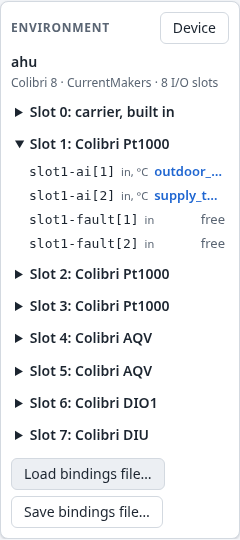
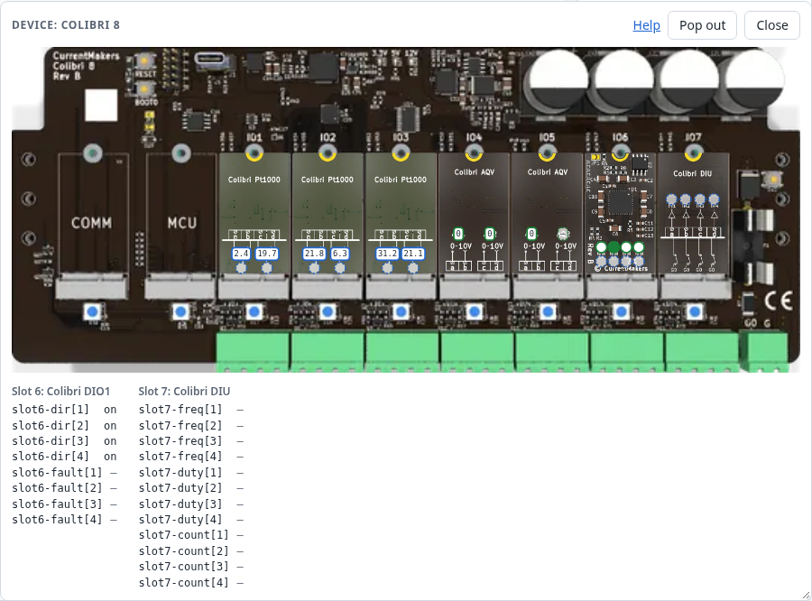
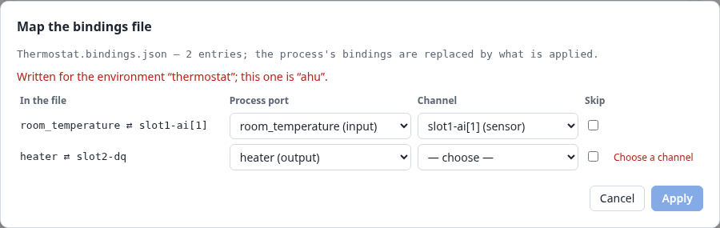

# 8. The environment

The environment is the controller's I/O: the channels of its modules. Processes reach it only
through bindings of their ports (Section 2.5). This chapter shows how to see the environment, how
to bind, and how to carry bindings from one controller to another.

## 8.1 The Environment panel

The panel below *Block types* describes the controller's I/O.

At the top:
- the environment's **name** (here `ahu`), with its description as the tooltip;
- the **carrier board**, with its vendor and number of I/O slots;
- the MCU module and the communication modules, when the controller reports them.

Then one group per **module**: *Slot 1: Colibri Pt1000*. Point at it for its type, vendor,
revision and serial number. Open a module to see its channels. Each channel shows:

- its **label**, as bindings name it: `slot1-ai[1]` is channel 1 of the port `ai` of the module in
  slot 1. A port with a single channel has no index: `slot2-dq`;
- **in** (a sensor, which processes read) or **out** (an actuator, which processes drive), with its
  unit;
- what it is **bound to**:
  - the process port, in the open process;
  - `Process: port`, in another process;
  - *free*.

Modules often have more channels than terminals: a Pt1000 module also reports a `fault` per
input (a broken or shorted sensor), and a DIO1 has a `dir` channel per terminal that makes it an
input or an output. They are ordinary channels that you can bind like any other.

The panel's buttons are *Device* (8.2), *Load bindings file…* and *Save bindings file…* (8.4).

A controller without an environment, such as hakkas on a desktop without the emulator, has no
panel. Its processes run, but bind nothing.

## 8.2 The device window

*Device* opens a picture of the controller, with every channel's live value where its terminal
is.

- **On the picture**: a number shows its value (three digits, without its unit), and a bool is a
  dot, filled when on.
  - Sensors are outlined in the accent color, actuators in the running color (blue and green in
    the light theme).
  - A dashed badge has no value yet: a sensor before its first reading, or an actuator that
    nothing has driven.
- **Pointing at a channel** shows its label, its value with its unit, its description and what it
  is bound to.
- **Below the picture**: channels without a terminal, such as a DIO1's directions or a DIU's
  counters, are listed by module.
- **Help**: the window's *Help* link, and a click on a module, open the vendor's documentation in a
  new tab.

The window floats over the editor so that the process stays in view. Resize it from its corner,
or choose *Pop out* to move it into a browser window of its own, for a second screen. *Close*,
or *Device* again, closes it.

The pictures come from the vendor's web site, with a copy on the controller for when that cannot
be reached. A module without a picture is drawn as a box with its name.

## 8.3 Binding process ports to channels

A binding connects a process port to a channel (Section 2.5):

- **A process input** is bound to one **sensor**. The input's block reads the sensor's value as its
  one source, so the input must have no connection and no fixed value.
- **A process output** drives one or more **actuators**.
- **An actuator** has one driver. A channel driven by one process cannot be bound by another, or by
  a second port.

**To bind:**
- Right-click a process port's marker and choose *Bind to environment…*.
- Or right-click a block's input or output directly and choose *Bind to environment…*. If no
  process port exposes it yet, the dialog makes one first, and asks its name.

The dialog lists the channels that fit: sensors for an input, actuators for an output. They are
grouped by port, with its unit and description. A channel that is already driven is listed
but cannot be chosen (*driven by …*).

**To unbind**, choose *Unbind from slot1-ai[1]* in the marker's menu, or in the block port's.
The process port stays. Unbinding:
- returns an input to its resting value, at once, like any removed connection;
- leaves an actuator at its last value. Nothing is written to it.

**A bound port** shows its channel at its marker (`⇄ slot1-ai[1]`). An output driving several
actuators shows the first and how many more (`⇄ slot6-dq[1] +1`). The inspector shows a bound
input as *From the environment: slot1-ai[1]*.

Bindings are part of the process: they are saved with it, undone like other edits, downloaded
with it (Chapter 9), and removed with its ports.

## 8.4 Bindings files

A process's bindings can be kept in a file of their own, for another controller or for later.

- **Save bindings file…** downloads the open process's bindings as `<process>.bindings.json`.
  The file names this controller's environment, and lists each binding by process port and
  channel.
- **Load bindings file…** reads such a file and **replaces** the open process's bindings with
  the file's:
  - If every entry fits, it is applied at once (*Thermostat.bindings.json: 2 bindings applied*).
  - If any does not, or the file was written for another environment, the mapping dialog opens
    (8.5).

You rarely need these files: downloading a process carries its bindings (Section 9.2). They are
handy when one process runs on several controllers with different wiring: keep one bindings file
per controller.

## 8.5 The mapping dialog

When bindings do not fit the controller, hakkas does not guess. The mapping dialog shows every
entry of the file, with a process port and a channel to choose. What fits is filled in already,
and the rest is for you.

Each row shows the entry as the file has it, then your choice of process port and channel, and
*Skip*. Beside each row is what is still wrong with it:
- *Choose a channel*;
- *Input already connected: heating.input*;
- a channel that is driven already.

A file for another environment says so at the top.

In the example, the thermostat's bindings meet the air handling unit's controller. The room
sensor's channel exists there too (`slot1-ai[1]`), but the relay's (`slot2-dq`) does not, so
the heater needs a channel chosen, or skipping.

*Apply* is possible once every row that is not skipped has no problem. It replaces the process's
bindings with the rows' bindings. *Cancel* changes nothing.

The same dialog opens when an uploaded process's bindings do not fit (Section 9.2): that is how a
process developed against the emulator meets a real controller whose modules sit in other slots.
