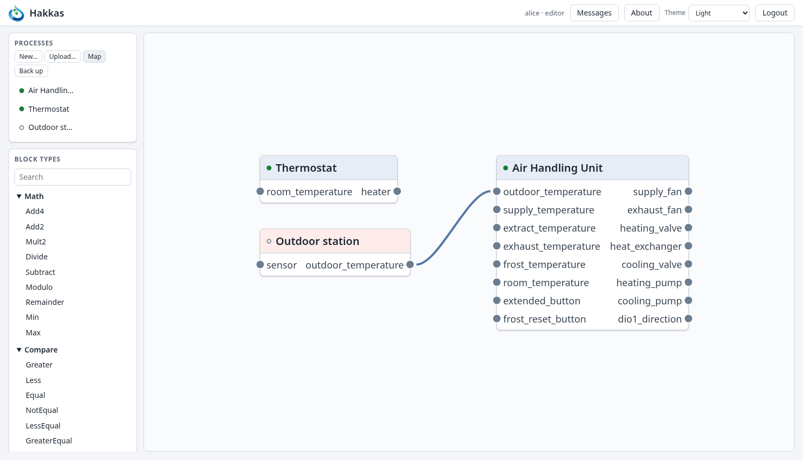

# 11. Links between processes

## 11.1 Links

A **link** connects one process's **output port** to another process's **input port** (Section
2.4). It carries a value from one process to the other, just as a connection does inside a
process: on change, through the same queue, with no delay of its own.

A typical use is one process that measures or computes something many others need, such as the
outdoor temperature, an occupancy signal or the season, and several processes that use it. Each
process stays complete in itself, with ports that say what it needs and what it offers, and the
links say who feeds whom on this controller.

The rules are those of connections:

- **An input port has one source:**
  - a link;
  - or a binding to a sensor (Chapter 8);
  - or, through its block, a connection or a fixed value.

  A link onto an input that already has a source is refused with *Input already connected*.
- **An output port may feed any number of links**, and drive actuators at the same time.
- **A process may link to itself**, an output port to one of its own input ports.
- **Removing a link** returns the input to its resting value, at once.
- **A stopped process's outputs keep their last values**, and so do the links from it. When it
  starts again, it sends its values over its links.

**Links end by themselves** when what they name goes away:
- either process is deleted;
- either port is removed;
- either port is **renamed**: a link names its ports, and the renamed port is no longer the
  port the link was made with.

Renaming a process or a block keeps its links.

## 11.2 The process map

*Map* above the process list shows every process and the links between them, in the editor's
place.

- **Each process** is a box with its name, its running mark and a red tint while it is stopped.
  Its input ports are on the left and its output ports on the right. Point at it for its
  description.
- **A port bound to the I/O** shows its channel (`⇄ slot1-ai[1]`).
- **Each link** is a line from an output port to an input port.

**The layout is automatic.** Processes that no other process feeds are in the first column,
and every other process stands right of the processes that feed it. The map arranges itself
again when a process, a port or a link comes or goes. You can drag a process aside to see
better, but the next change puts it back. Drag the empty map to move around, and use the wheel
to zoom.

**Making a link.** Drag from an output port's socket to an input port's socket. **Removing
one**: pull its end off the input port and drop it on the empty map, or right-click it and
choose *Delete link*. Ctrl+Z and Ctrl+Shift+Z (or Ctrl+Y) undo and redo your own link changes,
while the map is shown. As in the editor, a change someone else has made since is not undone.

**Opening a process.** Double-click it, or right-click it and choose *Open*. The browser's back
button returns to the map, whose address is `/?map`.

Editors and admins make and remove links. Viewers and operators see the map but do not change
it.

## 11.3 Saving and moving links

**Links are saved at once.** A link is wiring between processes, not part of any one process,
so making or removing one marks no process unsaved. The controller writes its links to its
storage straight away, and makes them again when it starts:
- after every process is loaded, and before any starts;
- so that each linked input sees its source's first value.

**In files** (Chapter 9):
- **A backup** holds every link, and restoring it makes them once the processes are there.
- **A single process's download** holds none, since a link reaches another process.
- **Uploading a process that replaces one on the controller** keeps that process's links. The
  upload makes them again after the new version, as long as the new version still has the ports
  they name.

The upload dialog says how many links it makes, and its report lists each.

::: tip Coming from IEC 61131-3
Links take the place of global variables shared between programs. They are explicit and
one-way, and each input has exactly one writer, so the map shows who feeds whom.
:::
