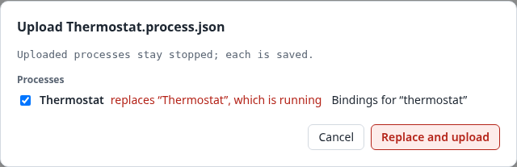

# 9. Moving work between systems

Processes move between controllers as files. The same file form carries one process or a whole
controller's backup. This chapter shows the usual way of working, and what travels and what does
not.

## 9.1 Develop against the emulator, deploy to a device

The safe way to build a control program is away from the plant:

1. **Describe the controller** as an environment file for the Colibri emulator: the carrier and
   its modules, slot by slot (Appendix D). The examples' files, such as
   `examples/thermostat/thermostat.json`, are a start.
2. **Build and test** the process on your desktop, against the emulator. Set the sensors by hand
   in the emulator's page, and watch the actuators in the device window. The examples are tested
   this way automatically, too (Section 13.10).
3. **Download** the process (9.2). The file carries the process, its bindings and the composite
   types it uses.
4. **Upload** it to the device. If the device's modules sit where the emulator's did, the
   bindings apply as they are. If not, the mapping dialog asks where each port goes (Section
   8.5).
5. **Start** it there. An uploaded process always arrives stopped (9.2), so that nothing is
   driven before you decide.

The same way works for any change later: change and test against the emulator, download, upload
again. The upload replaces the device's version of the process.

## 9.2 Download and upload

**Download** (⤓ on a process in the list) saves `<process name>.process.json` to your computer.
It holds:
- the process, as the controller has it (also unsaved changes);
- its bindings, with the environment's name;
- every composite type it uses, and the types those use.

Downloading changes nothing on the controller, and every role may download.

**Upload…** (above the process list) takes one or more files:
- process files;
- backups (9.3);
- type files, such as the standard library's `library/schedules/*.json`.

Before anything is sent, a dialog shows what will happen:

- **Each process** is *new*, or *replaces “…”* when the controller has a process with the same id.
  This is how deploying again updates a process. The dialog says when the process to be replaced
  is running. Untick a process to leave it out.
- **Each composite type** is one of:
  - *added*;
  - *already on the device*, unchanged;
  - *on the device and different: the device's is kept*. An upload never overwrites a type,
    since running processes may use it.

  A type the process needs that is neither in the file nor on the device is named. Its blocks
  will be refused.
- **The bindings**: *Bindings for “thermostat”*, or *not applied* on a controller without an
  environment.

*Upload* (or *Replace and upload*) then:

1. sends the types the controller lacks;
2. deletes each process that is replaced (it stops, and its saved files go);
3. makes each process again with its id, name and description, its blocks, values, ports and
   connections;
4. applies the bindings: at once if they fit, else through the **mapping dialog** (Section 8.5).
   Its *Cancel* uploads the process without bindings;
5. saves each process.

**An uploaded process stays stopped**, whatever its file says. On a device a running process
drives outputs at once, so starting it is your decision.

At the end, a report lists each process and type with anything that was refused or not
applied. For example, a block whose type the controller does not have is refused, and the rest
of the process is made. Closing the report opens the uploaded process.

Uploading is for editors and admins. It cannot be undone: download what an upload would replace
first, if you might want it back.

## 9.3 Backup and restore

**Back up** (above the process list) saves `<controller> <date>.backup.json`. It holds every
process with its bindings, and every composite type, in the same form as a process file. Every
role may make a backup.

**Restoring** is uploading a backup with *Upload…*: every process in it is added, or replaces the
controller's process of the same id. The processes are saved and stay stopped.

A restore does not remove anything: processes on the controller that are not in the backup stay
as they are. Restored onto another controller, a backup copies the first one's processes; where
the environment differs, the mapping dialog asks for the bindings.

Make a backup:
- before an update of the controller;
- before a large change;
- and regularly, as you would of a PLC program.

## 9.4 What is not carried over

Process files and backups carry processes, their bindings and composite types. They do not
carry:

- **Links between processes** (Chapter 11). They stay on the controller.
- **Users and passwords.** They belong to the controller, and a file must never carry secrets.
- **The controller's configuration**, such as its time zone, network settings or change
  threshold (Chapter 16).
- **The environment itself.** The modules are hardware; the file only names the environment it
  was bound on, so that the upload can tell when it meets another.
- **Live state.** A process starts afresh wherever it is started (Section 2.7): timers from zero,
  regulators from their manual values.
- **What you watch, select or have undone.** They belong to your browser, not to the process.

Upload is not atomic: if the connection is lost part way, what was made stays (a process without
some of its parts, unsaved), and the report says so. Upload the file again to replace it.
