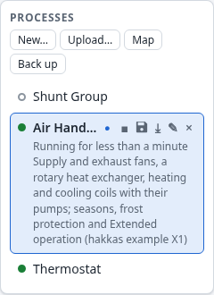

# 6. Processes

A controller runs any number of processes side by side, each started, stopped, saved and
edited on its own. This chapter covers the process list and what happens to processes when the
controller restarts.

## 6.1 The process list

Each row shows:

- **its state**: a green dot while it runs, a hollow grey one while it is stopped;
- **its name**: the full name is the tooltip when it is cut short;
- **the unsaved mark** ●, when it has changes that are not saved (6.4).

Its actions, shown on the open process and on the one you point at:

| Button | Action | Who |
|---|---|---|
| ▶ / ■ | start / stop | operators, editors, admins |
| disk | save (Ctrl+S for the open process) | editors, admins |
| ⤓ | download (Chapter 9) | everyone |
| ✎ | rename | editors, admins |
| × | delete | editors, admins |

**The open process** is highlighted. It also shows how long it has been running ("Running for 5
min") or *Stopped*, and its description. While it is stopped its row is tinted red: a stopped
process's outputs keep their last values, and that should not go unnoticed.

Above the list:
- *New…* creates a process;
- *Upload…* and *Back up* move processes between controllers and files (Chapter 9);
- *Map* shows every process and the links between them (Chapter 11).

**Addresses.** The browser's address names the open process (`/?process=…`), so you can
bookmark it or send it to a colleague. The browser's back and forward buttons move between the
processes you opened.

## 6.2 Creating, renaming and deleting

**Creating.** *New…* asks for a name and a description, and the new process opens, empty and
stopped. The description is set here only, and shows under the name of the open process. Pick a
name that tells processes apart in the list: what the process controls, and where.

**Renaming.** Double-click the name, or choose ✎. Enter or leaving the field renames it, and
Escape keeps the old name. Any text is a valid name. The process keeps its id, so bindings,
links and bookmarks are unaffected.

**Deleting.** × asks first, naming the process: *Delete “Thermostat”? It is stopped, and its saved
file is removed too.* The process is stopped and its saved files go: the process and its
bindings. The channels it drove keep their last values. There is no undo: download the process
first (Chapter 9) if you might want it back.

## 6.3 Start and stop

**Starting** a process starts all its blocks at once. Each computes from its inputs as they are,
and the results travel through the process. Everything takes its state from its inputs at once:
- a thermostat switches the heater as the room is now;
- a schedule block is true if it is now office hours;
- a regulator starts in the mode its inputs say.

Timers and regulators start afresh (Section 14.7).

**Stopping** a process stops its blocks. Nothing computes any more, and every output, including
those that drive actuators, **keeps its last value**. A stopped process does not switch anything
off. If outputs must go to a safe state, make that state part of the design and switch it from
within the process, for example through an input that an operator sets (Section 14.7).

Starting or stopping marks a process unsaved (6.4), since whether it runs is part of what is
saved.

**Editing a running process** is normal: every change takes effect at once (Section 2.7). There
is no need to stop a process to change it.

## 6.4 Saving, and what happens at a restart

The controller holds every process in memory. **Saving** writes the open process to the
controller's storage:
- its blocks, connections, fixed values and ports;
- its bindings (Chapter 8);
- whether it is running.

The save button, or Ctrl+S, saves. A notice confirms it. If the save fails, for example when the
storage is full, a dialog says so and stays until you close it, and the unsaved mark stays.

**A process is unsaved** after any change to it, including a start or a stop, a binding, or a
change made by someone else. The mark is the same for everyone looking at the list.

**At a restart** (a power cut, an update, a restart by an administrator), the controller loads
each saved process **as it was saved**:
- Unsaved changes are lost.
- A process saved while running starts again.
- A process saved while stopped stays stopped.

So *save while running* is how you say "start this at power-up".

**A block type that is missing** at a restart, typically a composite type that was not
installed, does not destroy anything. The block loads as a **placeholder**:
- It has no ports and takes no part in the dataflow.
- It keeps its type's name, its position and its connections, and a save writes them back
  unchanged.
- The controller's log has a warning about it.

Install the missing type and restart, and the block works again.

## 6.5 Several people editing at once

Any number of people can have the same controller open, also the same process. Each sees the
others' edits as they happen, because every browser draws what the controller reports (Section
2.7).

A few things follow from that:

- **There is no locking.** Two people can edit the same process at the same time. If both change
  the same thing, the later change wins, as on the controller. Agree who edits what.
- **Undo is per person.** Ctrl+Z undoes only your own steps, and skips one that someone else has
  changed since (Section 5.10).
- **Selection and watches are per person.** What you select and watch is not shown to others.
- **Saving saves everything.** A save writes the process as it is, with everyone's changes.
- **Deleting is for everyone.** If someone deletes the process you have open, your editor goes
  empty.
