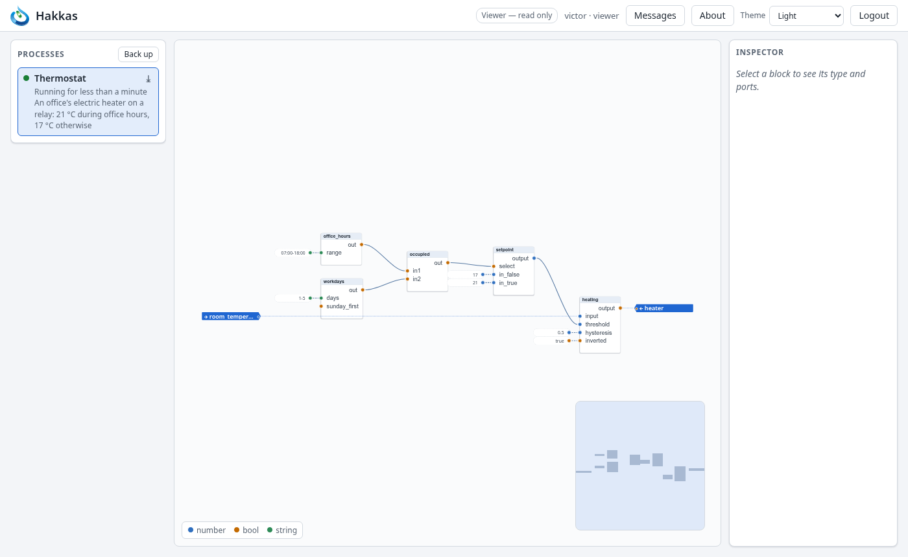
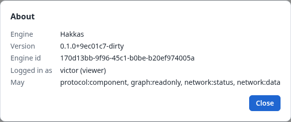

# 10. Users, roles and sessions

Everyone who uses a controller logs in as a user, and every user has a role. The role decides what
the editor offers and what the controller accepts. Users are created by an administrator on the
controller itself (Section 16.3). There is no user management in the editor.

## 10.1 Roles

| Role | May |
|---|---|
| **viewer** | see every process, its values, the I/O and the device window; select and copy blocks; download processes and make backups |
| **operator** | everything a viewer may, and start and stop processes |
| **editor** | everything an operator may, and change processes; create, rename, save, delete and upload them; bind to the I/O; create composite types and upload type files |
| **admin** | the same as an editor, for now; reserved for managing users from the editor later |

**The editor offers only what your role allows.** A viewer sees no *New…*, no block types and no
editing items in the menus. The inspector is read-only, and dragging a block or a line does
nothing. The top bar says what that means: *Viewer — read only*, or *Operator — starts and stops,
no editing*.

**The controller checks too.** Every command is checked against the role by the controller
itself, so a browser that offered more could still do no more. A refused command shows the
controller's message, such as *Not permitted: graph:addnode*.

*About* in the top bar shows the controller you are connected to (its name, version and id) and
your user, role and permissions in the controller's own terms.

**Choosing roles.** Give each person the least role that lets them do their job:
- a viewer for those who follow the plant;
- an operator for those who run it;
- an editor for those who change its programs.

An operator's stop is a powerful action (Section 6.3).

## 10.2 Sessions

**Logging in.** Your password never travels over the network: the browser proves to the
controller that it knows it, and the controller proves to the browser that it knows you. A
controller that cannot prove it is refused, with *The server could not prove its identity*.

**Staying logged in.** A session survives a reload of the page, and closing and opening it again:
hakkas keeps a one-time key for it in the browser, never the password. It ends:

- **after 30 minutes without activity**;
- **after 12 hours in all**;
- **when you choose *Logout***;
- **when the controller restarts**: it forgets its sessions, so everyone logs in again.

An administrator can change both times (Section 16.2). When a session ends, the editor returns to
the login screen. A session that ended normally asks for the password without an error.

**A lost connection** is not the end of a session. The editor stays as it was but read-only, its
live values struck through, and a banner says that it is reconnecting:
- It tries again after 1, 2, 4, 8 and 16 seconds, then every 30 seconds; *Retry now* tries at once.
- Once back, it reopens the process you had open and watches what you watched.
- If the session ended meanwhile, it asks you to log in again.

**Failed logins.** After three failed logins the connection is closed. Repeated failures from one
address are slowed down, by up to a minute per attempt, so that passwords cannot be guessed
quickly. A person who mistyped waits at most a moment.

**Several tabs and people.** Each browser tab has its connection, its undo history and its
watches. Tabs of one browser share the login. Any number of users can be logged in at once (an
administrator can limit the number of connections), and each sees the others' edits as they
happen (Section 6.5).
